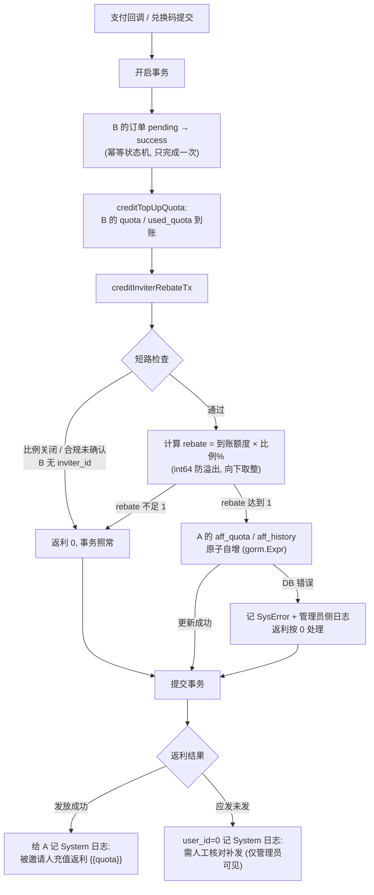
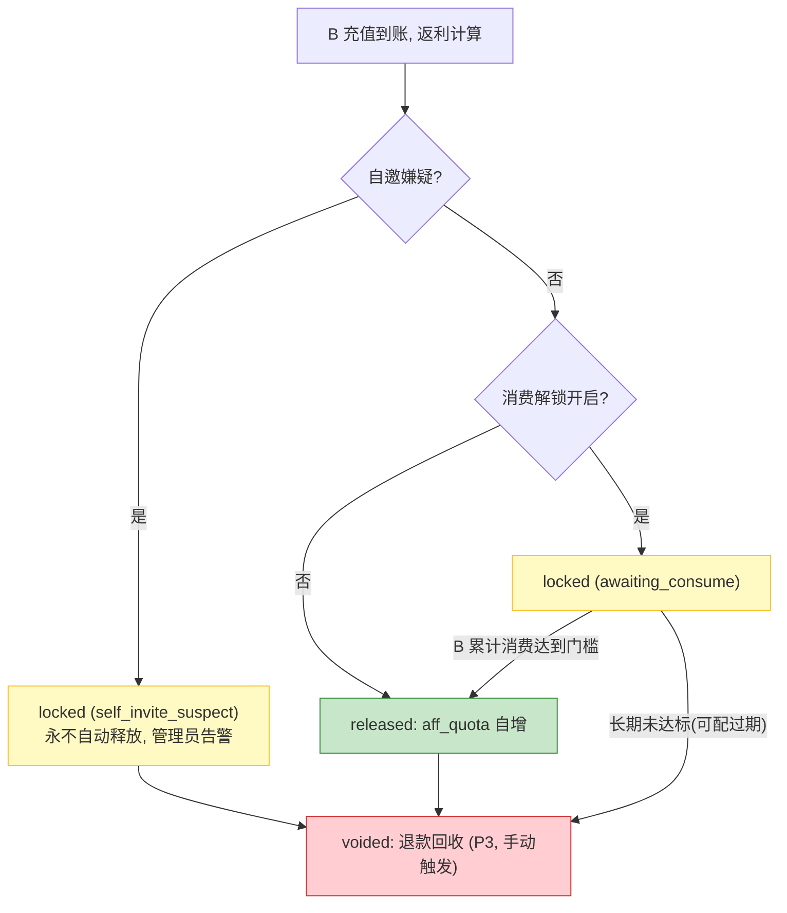

# 邀请充值返利（Inviter Recharge Rebate）

被邀请人 B 充值到账时，按可配置比例给邀请人 A 发放返利。本文档记录已上线的 v1 行为，以及 2.0（风控 → 激励 → 运营）的规划。

## 一分钟速览

整个邀请返利就是四句话：

1. **返利何时发生**：B 充值钱到账（线上支付或兑换码）→ 按 `InviterRebatePercent` 比例算出一笔额度 → 加到 A 的"邀请收益"（`aff_quota`，需 A 手动划转，不自动进余额）。
2. **兜底铁律**：返利出任何问题**都不影响 B 的充值**——充值照常到账，返利失败只记管理员日志，人工补。
3. **2.0 只改一件事**：把"直接加到 A 账上"改成**先记账到台账表**，每笔返利有 locked（冻结）/ released（到账）/ voided（作废）三个状态。
4. **2.0 的三步棋**：风控（冻结到 B 真消费才发放 + 封顶 + 自邀检测）→ 激励（首充加成 + 阶梯比例）→ 运营（排行榜 + 看板）。

```
B 充值到账
   │
   ▼
计算返利（比例 × B 的到账额度）
   │
   ▼
┌─ v1（现在）：直接进 A 的邀请收益池，完事
│
└─ v2（规划）：先记台账
      │
      ├─ B 还没真消费/有自邀嫌疑 → 冻结（locked），拿不到
      ├─ B 消费达标           → 释放（released）进收益池
      └─ B 退款/超封顶        → 作废（voided），一分不出
```

细节按需查阅下文：不想读设计正文，直接看下一节"场景速查"（18 个真实例子）；v1 行为与失败语义 → "v1：已实现的行为"；三态状态机与各期设计 → "2.0 规划"。

## 场景速查

用三个固定人物把所有场景走一遍。设定：返利比例 10%，消费解锁门槛 10 美元，金额均以美元表述（$1 = 500,000 额度）。

**人物**：阿明（A，邀请人，拉新赚返利的正常用户）；小红（B，被邀请人，被阿明的邀请链接注册）；老王（注册两年的真实老用户）。

### v1（现在线上）

| # | 场景 | 结果 |
| --- | --- | --- |
| ① | 正常发放：小红充 50 → 返利 50 × 10% = 5 进阿明收益池 | 阿明日志多一条"被邀请人充值返利 5"，手动划转后可用 |
| ② | 零头不足 1：小红充 4.5 → 返利 0.45 不足最小单位 | 不发，充值正常。防刷小额凑零头 |
| ③ | 自然用户：老王 `inviter_id = 0`，充 100 | 返利 0，一切照旧 |
| ④ | 返利失败：小红充 50，发放返利时数据库抖了 | **小红的 50 照常到账、订单成功**；阿明没收到 5，管理员日志后台有"返利 5 发放失败，需人工核对"记录，站长手动补 |
| ⑤ | 邀请人跑路：阿明账号被硬删除，小红充 50 | 返利无处可去，静默作罢，充值正常 |

### v2：消费解锁（门槛 10 美元）

| # | 场景 | 结果 |
| --- | --- | --- |
| ⑥ | 新用户正常解锁：小红充 50 → 返利 5 先冻结；之后调 API 用掉 10 → 达标 | 冻结的 5 **自动释放**进阿明收益池 |
| ⑦ | 先消费后充值：小红注册后先烧注册赠送额度调了几天 API（累计消费 12），之后首次充 100 | 累计口径下已达标 → 返利 10 **直接发放，不冻结** |
| ⑧ | 自邀小号永久锁死：小号B 充 50 从不消费 | 永不达标 → 阿明**一分拿不到** |

### v2：自邀检测

| # | 场景 | 结果 |
| --- | --- | --- |
| ⑨ | IP 撞车：小号B 的注册/登录 IP 与阿明近 90 天登录 IP 重合（强信号） | 返利标记 `locked(self_invite_suspect)`，永不自动释放 + 管理员告警；站长查证后手动作废（真自邀）或放行（夫妻共用 WiFi） |
| ⑩ | 弱信号不误杀：邮箱同域且前缀相似（单个弱信号） | 不触发；弱信号需两个叠加才命中 |

### v2：封顶（单笔 20 美元 / 月度 100 美元）

| # | 场景 | 结果 |
| --- | --- | --- |
| ⑪ | 单笔封顶：土豪被邀请人充 500 → 本应返 50 | 只发 20，超出部分不记台账；B 的到账不受影响 |
| ⑫ | 月度封顶：阿明本月累计返利已 95，小红再充 100 → 本应 +10 | 这 10 作废（voided, monthly_cap）+ 管理员日志；下月 1 号重置 |

### v2：首充加成与阶梯

| # | 场景 | 结果 |
| --- | --- | --- |
| ⑬ | 首充加成 15%：小红**第一笔**充 50 → 按 15% 发 7.5（台账记 percent=15）；第二笔充 50 → 回落 10% → 5 | 首充加成只对 B 的第一笔成功充值生效 |
| ⑭ | 阶梯 0–5 人 10% / 6–20 人 12% / 21+ 人 15%：阿明已邀请 7 人 | 名下新返利按 12% 算；升档后按新档，**已发的不追溯** |
| ⑮ | 首充 × 阶梯取大：阿明 12% 档，小红首充 | 12% vs 首充 15% 取大者 15%；先取比例 → 算金额 → 最后截封顶 |

### v2：退款回收

| # | 场景 | 结果 |
| --- | --- | --- |
| ⑯ | 退款、返利还冻着：小号B 充 50 后秒退款 | 返利 5 还是 locked → 站长点"来源充值已退款" → 作废，一分没亏 |
| ⑰ | 退款、已释放未划转：小红解锁拿了 5 后退款，阿明收益池没动 | 站长点回收 → 从阿明收益池扣回 5，台账作废 |
| ⑱ | 退款、已划转花掉：阿明早把 5 划到余额花光 | 收益池扣到 0，差额记**欠账**（只记账不动余额），站长人工决定追不追 |

所有场景共用同一条铁律：**B 的充值本身永远不受任何返利环节影响**（④⑧⑪⑫⑯ 都能看出来）。

## v1：已实现的行为

实现提交：`37d95e659`（feat: 邀请充值返利，被邀请人充值到账按比例返利给邀请人）。

### 功能概述

被邀请人 B 的充值到账时，按整数百分比把 B 的到账额度折算成返利发给邀请人 A，进入 A 的邀请收益（`aff_quota` / `aff_history`），沿用"邀请收益手动划转"模式，不自动进余额。

### 配置

| 配置项 | 位置 | 默认 | 说明 |
| --- | --- | --- | --- |
| `InviterRebatePercent` | 管理端"额度设置"（`InviterRebatePercent` 数字输入） | 0 | 整数百分比 0–100；0 = 功能整体关闭 |

写入校验：范围 0–100（越界拒绝保存）；正值保存需通过支付合规确认门（与 `QuotaForInviter`/`QuotaForInvitee` 同一门控 `IsPaymentComplianceConfirmed`）。

### 触发范围

| 充值路径 | 触发 | 挂接位置 |
| --- | --- | --- |
| 易支付 | ✅ | `RechargeEpay`（`model/topup.go`） |
| Stripe | ✅ | `Recharge`（`model/topup.go`） |
| Creem | ✅ | `RechargeCreem`（`model/topup.go`） |
| Waffo | ✅ | `RechargeWaffo`（`model/topup.go`） |
| Waffo Pancake | ✅ | `RechargeWaffoPancake`（`model/topup.go`） |
| 兑换码 | ✅ | `Redeem`（`model/redemption.go`） |
| 人工补单（`ManualCompleteTopUp`） | ❌ | — |
| 订阅购买 | ❌ | — |

### 充值到账流程（含返利）



关键不变式：**返利失败绝不回滚 B 的充值**——返利只是充值的附加收益，事务始终照常提交。

### 边界行为

| 场景 | 行为 |
| --- | --- |
| `InviterRebatePercent = 0` | 整个功能静默关闭，零开销 |
| 支付合规未确认 | 不发放返利（与正向奖励同一门控） |
| B 的 `inviter_id = 0`（自然注册） | 无返利，充值正常 |
| 返利向下取整后 < 1 | 不发放（零头不记台账、不进 `aff_quota`） |
| A 已被硬删除（`RowsAffected = 0`） | 视为无返利，不报错，不影响充值 |
| A 已被软删除 | 返利照发（行仍存在；与 v1 范围一致） |
| 重复支付回调 / 重复兑换 | 订单状态机保证只完成一次，返利只发一次 |
| 查询 B 的邀请人失败（DB 异常） | 仅记服务器控制台日志，返利 0，充值照常提交 |

### 日志与可见性

| 日志 | 归属 | B 能否看到 | A 能否看到 | 管理员能否看到 |
| --- | --- | --- | --- | --- |
| B 的充值成功日志（`RecordTopupLog`，原有） | B | ✅ | ❌ | ✅ |
| 返利成功日志"被邀请人充值返利 {{quota}}" | A（`LogTypeSystem`） | ❌ | ✅ | ✅ |
| 返利发放失败日志（含应发金额、双方 ID） | `user_id=0`（`LogTypeSystem`） | ❌ | ❌ | ✅（`/api/log/` 挂 AdminAuth） |
| 数据库错误详情 | 服务器控制台（`common.SysError`） | ❌ | ❌ | 运维侧 |

失败日志走 `user_id=0` 归属的原因：用户侧日志接口 `/api/log/self` 只按 `user_id` 过滤、不区分日志类型，任何归属到具体用户的日志都会被本人看到；失败细节（应发金额、双方账号）不应暴露给 A 或 B，因此记在系统名下，只出现在管理员的全量日志查询里。

### 失败语义（关键设计）

返利 DB 失败**绝不回滚 B 的充值**：

- 查询/更新失败时记 `common.SysError` 系统错误日志（含双方 ID 与应发金额），函数返回 0，事务照常提交
- 更新失败时额外在 logs 表 `user_id=0`（系统归属）名下写一条 `LogTypeSystem` 记录——`/api/log/` 全量日志挂 AdminAuth，A/B 的 `/api/log/self` 按 user_id 过滤查不到，因此**仅管理员可见**，内容含应发额度与双方 ID，供人工核对补发
- 由于充值照常提交、幂等状态机不会重放，失败返利不会自动补发，需人工处理
- 查询邀请人失败的分支只记服务器控制台日志（数据库本身异常时日志表写入大概率同样失败）

### 实现说明

- 核心函数 `creditInviterRebateTx`（`model/user.go`），在充值事务内、`creditTopUpQuota` 成功之后调用；全部决策（短路、计算、落账、失败降级）收口在这一个函数，6 处挂接点只负责传参与事务后记日志
- 返利计算 `int(int64(creditedQuota) * int64(InviterRebatePercent) / 100)`：int64 中间量防溢出，整数除法天然向下取整
- 落账用 `gorm.Expr("aff_quota + ?")` 原子自增，与 `inviteUser` 同模式，方言无关；**不改 `aff_count`**（其语义是"邀请人数"）
- 无数据库 schema 变更（复用 `users.aff_quota` / `aff_history` / `inviter_id`），无需迁移
- 测试见 `model/coverage_test.go`（7 个用例：易支付发放、比例关闭、合规门、兑换码、无邀请人、失败不阻断充值、失败日志仅管理员可见——最后一个用 GORM callback 注入 UPDATE 错误验证降级路径）

## 2.0 规划：风控 → 激励 → 运营

### 架构基座：返利明细台账

v1 的返利是无明细的原子自增，冻结、释放、封顶统计、回收、排行、看板都无从谈起。三期共同的地基是一张台账表：

新表 `inviter_rebates`（GORM AutoMigrate）：

| 字段 | 说明 |
| --- | --- |
| `id` / `created_at` | |
| `inviter_id` / `invitee_id` | 双索引 |
| `source_type` / `source_id` | topup / redemption，幂等去重键 |
| `base_quota` / `percent` / `quota` | 当时基数、比例、返利额（比例入账留档，改配置不追溯） |
| `status` | `locked` / `released` / `voided` |
| `locked_reason` | `self_invite_suspect` / `awaiting_consume` / 空 |
| `released_at` / `voided_reason` | |

状态机：



- `users` 表加 `aff_quota_locked` 冗余列（冻结池计数，避免高频 `SUM(ledger)`）；`aff_quota` 语义不变 = 已释放可划转
- 兼容性：存量已发返利无明细，台账从上线起从零记录，`aff_quota` 存量值不追补
- 挂接点不变（6 处 + `creditInviterRebateTx` 收口），函数内部从"直接 UPDATE users"改为"INSERT 台账 + 按状态决定是否同步 UPDATE users"

### Phase 1 风控（P0）：堵小号套利

v1 的已知漏洞：A 注册小号 B 自己充值，等于拿 110% 价值（B 到账 100 + A 返利 10），B 的额度对 A 有变现渠道时闭环成立。

**1.1 封顶**

| 配置项 | 单位 | 默认 | 行为 |
| --- | --- | --- | --- |
| `InviterRebateMaxPerTopup` | 原始额度整数（quota，UI 用 formatQuota 提示换算） | 0 = 不限 | 单笔截断，超出部分不记台账 |
| `InviterRebateMonthlyMax` | 原始额度整数（quota） | 0 = 不限 | 自然月台账累计达标后，当月后续返利 `voided(monthly_cap)` |

实现口径（P1.1 已上线）：

- 截断顺序：先算返利 → 单笔封顶截断 → 月度封顶判定 → 消费解锁分支。两配置均非负整数校验，**不挂支付合规门**（封顶只减不加支出）
- 月度统计口径：自然月内 `status IN (released, locked)` 的台账 `SUM(quota)`（voided 不计、冻结池同样占额度），月起点为服务器本地时区；上月记录不占本月额度
- 命中月度封顶的两种形态：已达上限 → 整笔 `voided(monthly_cap)` 留痕；本笔会超但未达上限 → 只发剩余额度，**超出部分不记台账**（`(inviter_id, source_type, source_id)` 唯一，一笔充值至多一行，无法为截断部分单独留行）
- 管理员日志：`creditInviterRebateTx` 增第四个返回值 `cappedRebate`（被月度封顶作废/砍掉的金额），调用方在事务提交后写 `user_id=0` System 日志（key：`Invitation rebate {{quota}} withheld due to the inviter monthly cap`，与 v1 失败日志同通道，仅管理员可见）；部分截断与整笔作废都写。**单笔封顶属正常策略截断，不写日志**
- 月度 SUM 查询失败按返利失败处理（failedRebate 返回全额走人工核对通道——比漏发更安全的失败方向）；台账作废行插入抽出公共函数 `insertVoidedInviterRebateTx`（inviter_missing / monthly_cap 共用）
- B 的充值不受任何封顶影响

**1.2 消费解锁（核心防线）**

- 配置 `InviterRebateConsumeUnlockQuota`（原始额度整数存储，沿用 `QuotaForInviter` 模式，UI 用 formatQuota 提示换算；默认 0 = 不解锁，维持直接 released）
- 返利先进 `locked(awaiting_consume)` 冻结池（`users.aff_quota_locked`），B **累计**消费额度（`users.used_quota`）≥ 门槛后释放；充值前的消费同样计数（已拍板：累计口径）；充值到账时若 B 已达标直接 released
- 释放钩子：`used_quota` 的三个真实落库点（`DecreaseUserQuota` 只减余额、不写 used_quota，**不是**扣费收口）：`UpdateUserUsedQuota` 直写分支 / `updateUserUsedQuotaAndRequestCount` / 批量刷新 `updateUserQuotaUsedQuotaAndRequestCount`（`model/user.go`、`model/utils.go`），quota > 0 时内联触发（负值 = 退款不触发）；释放走单事务：台账行 lockForUpdate 圈定 → 邀请人行锁定 → 行翻 released + 邀请人入账，失败整体回滚、下次消费重试，不会重复入账
- 释放到账时给邀请人写一条聚合 System 日志（key：`Invitation rebate {{quota}} released after invitee consumption`）；锁定期间不写日志（钱还没到账）
- 锁定路径沿用"钱先落、台账后记"：`aff_quota_locked` 更新成功但台账插入失败时额度冻结在池中无法释放，只 SysError 不回滚（与 Phase 0 released 路径同口径）
- 设计依据：小号充了钱不消费，A 永远拿不到——这条本身就是最强的自邀防线
- 两个口径事实：① `inviter_id` 只在注册时通过邀请码绑定，之后无补绑入口，被邀请人必然是新注册账号；② 累计口径下 B 烧**注册赠送的免费额度**也计数——白送的钱也能凑解锁。规避：**门槛默认值设得高于注册赠送额度**（如赠送 2 美元则门槛 ≥ 10 美元），并在配置描述里注明
- 冻结池过期（决策③，已上线）：配置 `InviterRebateLockExpiryDays`（默认 0 = 不过期；非负整数校验）；> 0 时 `created_at` 超期仍未解锁的 locked 返利自动作废
  - 清扫范围**只圈 `locked(awaiting_consume)`**：`locked(self_invite_suspect)` 永不自动作废（决策②，嫌疑行只能等 P3 人工裁）；released/voided 行天然不命中
  - 定时任务 `service/inviter_rebate_expiry_task.go`：仅主节点运行（多节点不重复作废），每小时一跳，批次 300 连续排干（短批即停）；批次失败整体回滚、下一跳重试
  - `model.ExpireInviterRebateLocks` 单事务：先按 status+reason+cutoff 圈 id，事务内 `lockForUpdate` 重新过滤（防与消费解锁释放钩子竞态——被抢先释放的行自然出局），行翻 `voided(lock_expired)` 后按邀请人聚合回落 `aff_quota_locked`
  - 邀请人已被硬删：行照样作废（user UPDATE 影响 0 行无副作用，钱无处可去），管理员日志照写（台账留痕优先）
  - 管理员日志：作废发生即给对应邀请人写 `user_id=0` System 日志（key：`Invitation rebate {{quota}} expired from the locked pool and voided`，含 inviter_id；与封顶/嫌疑告警同通道）；错误日志 key：`inviter rebate lock expiry failed: error=%s`
  - 测试覆盖：超期作废并回落冻结池、后续正常释放不受影响、self_invite_suspect 永不作废、默认 0 关闭时清扫 no-op、邀请人硬删仍作废并留日志

**1.3 自邀检测（辅助信号，降档处理）**

| 信号 | 来源 | 强度 |
| --- | --- | --- |
| 登录 IP 精确重合 | `user_sessions.ip`：双方近 90 天 IP 交集（`net.ParseIP` 归一化，IPv4-mapped IPv6 折叠） | 强 |
| 支付账号重合 | `users.stripe_customer` 双方非空且相同（epay 无对应字段，暂不覆盖） | 强 |
| 邮箱相似 | 同域 + local part 小写公共前缀 ≥ 较短方一半（不足 3 字符视为不相似） | 弱（需两个弱信号叠加） |
| IPv4 同 /24 | 双方近 90 天 IP 的前三字节相同且无精确重合 | 弱（需两个弱信号叠加） |

实现口径（P1.3 已上线）：

- 配置 `InviterRebateSelfInviteCheck`（默认开）；截断顺序中位于**月度封顶之后、消费解锁判定之前**——即使 B 累计消费已达标也照样冻结，嫌疑优先于解锁
- 判中：整笔进冻结池 `aff_quota_locked` + 台账 `locked(self_invite_suspect)`，**永不自动释放**（`releaseInviterRebatesOnConsume` 只圈 `awaiting_consume` 行）；锁后 B 继续消费也不解锁。人工 void / release 操作随 P3 台账页提供
- 管理员告警：`creditInviterRebateTx` 增第五个返回值 `suspectRebate`（嫌疑冻结全额，即使冻结失败/作废也告警，与失败日志互补），调用方在事务提交后写 `user_id=0` System 日志（key：`Invitation rebate {{quota}} held for self-invite suspicion, manual review required`，含 inviter_id/invitee_id）
- 信号查询失败按无嫌疑处理（失败方向：漏放有封顶 + 消费解锁兜底，误冻需要人工善后）；某一方近 90 天无会话记录时 IP 类信号自然不命中，Stripe 与邮箱信号不受影响
- 冻结分支与消费解锁共用 `lockInviterRebateTx(lockedReason)`；锁定失败语义同消费解锁（failedRebate 走人工通道）
- 测试覆盖：精确 IP 重合冻结、嫌疑压过消费解锁且后续消费不解锁、Stripe 账号重合、单弱信号不触发 / 双弱信号叠加触发 / 90 天窗口外的旧会话忽略、开关关闭时正常发放

### Phase 2 激励：改动小、效果直接

**2.1 首充加成（已实现）**：

- 配置项 `InviterRebateFirstTopUpPercent`（旧式扁平 option，默认 0）：被邀请人**第一笔成功充值**的返利比例；0 = 无首充加成，恒用常规比例。取值 0–100，校验复用现有 "Inviter rebate percentage must be an integer between 0 and 100" 错误 key；受支付合规门管控（与 `InviterRebatePercent` 同组）。基础比例 0 + 首充比例 > 0 是合法配置（只有首充产生返利）
- 首充判定：`inviterRebatePercentForTx` 在返利事务内查 `topups WHERE user_id = B AND status = success` 计数。各 `Recharge*` 路径在调用返利钩子**之前**已把当前订单置为 success，因此计数 == 1 即首充（含当前笔）。人工补单（`ManualCompleteTopUp`）同样会翻转 status，故也计入"成功充值笔数"——属既定行为
- 兑换码等非充值来源（`sourceType != InviterRebateSourceTopUp`）**不适用**首充加成，恒用常规比例
- 计数失败时记 SysError 日志并**回退常规比例**（失败方向取保守侧：漏加成可人工补，多发不可收回），返利照发、充值不回滚
- 生效比例快照在台账行 `percent` 字段留档（released / locked / voided 全部路径）；后续调比例不影响历史行
- 管理端「系统设置 → 计费」新增输入行（zod `z.coerce.number().int().min(0).max(100)`），i18n 覆盖 7 语言
- 测试覆盖（`model/coverage_test.go`）：首充用首充比例且第二笔回落常规、基础比例 0 仅首充返利、兑换码不适用首充加成、消费解锁下锁定行同样记录首充比例

**2.2 阶梯比例（已实现）**：结构化 JSON，走 `setting/operation_setting` 现成模式（`config.GlobalConfig.Register`，同 `quota_setting.go`）。注意 **`first_topup_percent` 不在 JSON 里**——首充加成保持 2.1 的扁平 option `InviterRebateFirstTopUpPercent` 不变，JSON 只管阶梯：

```json
{ "tiers": [ {"min_invitees": 0, "percent": 5},
             {"min_invitees": 6, "percent": 10},
             {"min_invitees": 21, "percent": 15} ] }
```

- 配置项 `inviter_rebate_setting.tiers`（`setting/operation_setting/inviter_rebate_setting.go`）：`[{min_invitees, percent}]` 数组，最多 20 档
- **阶梯完全取代扁平比例**：配置了非空阶梯后 `InviterRebatePercent` 不再参与常规比例；被邀请人数低于最低档门槛的邀请人**不产生返利**。"人人有份"需要一档 `min_invitees = 0` 的基础档
- 空串 / null / `[]` 均合法 = 阶梯关闭，回退扁平比例；运行时解析失败（非法 JSON / 非数组）记 SysError 日志并降级为扁平比例（返利照发，失败方向取保守侧）
- 分档判定：按 A 的 `aff_count` 升序走一遍，取满足 `min_invitees <= aff_count` 的最高档；`aff_count` 查询失败时记 SysError 并回退扁平比例
- 首充叠加：首充比例 = `max(InviterRebateFirstTopUpPercent, 常规比例)`，常规比例来自阶梯或扁平（同 2.1 语义）
- 返利总开关（合规门之外）：扁平 > 0 **或** 首充 > 0 **或** 任一档 percent > 0 即启用，否则短路无返利
- 写入校验（前后端同错误文案）：percent 整数 0–100、min_invitees 非负整数、`min_invitees` 严格递增、档数 ≤ 20
- 生效比例快照在台账行 `percent` 字段留档（同 2.1）；后续调整阶梯不追溯已发返利
- 前端：管理端「系统设置 → 计费」新增可视化阶梯编辑器（JSON 字符串表单字段 + 行内增删改，模式同 `tool_price_setting.prices`），zod 校验与后端逐条对齐，i18n 覆盖 7 语言
- 测试覆盖：`setting/operation_setting/inviter_rebate_setting_test.go`（合法/非法各分支、边界 20 档、严格递增）；`model/coverage_test.go`（分档取值、低于最低档 0 返利、阶梯取代扁平、首充取大、解析失败降级、aff_count 失败回退）

叠加强校验：先取比例 → 算金额 → 再截断（封顶），结果永远 ≤ 100% 且 ≤ 封顶。

### Phase 3 运营：依赖台账数据

- **邀请排行榜**：管理端（`GET /api/inviter_rebate/rankings`，AdminAuth）按返利总额/邀请人数、月/季/年聚合（已拍板：纯管理端，不做公开版）。现有 `/rankings` 是模型维度公开榜，不混用。公开邀请人数榜（不含金额）留作后续运营可选项，随时可加
  - 实现口径（P3.1 后端已上线，前端页面随 P3.2）：query 参数 `metric=rebate|invitees`（默认 rebate）、`period=month|quarter|year|all`（默认 month）+ 通用分页（`common.GetPageQuery`，PageInfo 响应）；非法取值走 `ApiErrorT`（错误 key `Invalid inviter rebate rankings metric/period: {{value}}`，i18n 覆盖 7 语言）；access token 访问需 `billing:read` scope（`middleware/access_token_routes.go`，后续 /inviter_rebate 组的新路由同此登记）
  - 聚合口径与月度封顶一致：`granted_quota = released + locked` 之和（冻结池同样算邀请人收益），`voided` 单列不计入排序口径；每行同时带出 `released/locked/voided` 分项、`rebate_count`（台账行数）、`invitee_count`（周期内产生过台账行的被邀请人数，`COUNT(DISTINCT invitee_id)`）与 `users.aff_count`（注册绑定的邀请人数，口径不同，供对照）
  - period 按自然月/季/年对齐（与月度封顶同一对齐方式，季起点为所属季度首月 1 号）；`all` 不过滤
  - 排序：metric 对应列（granted_quota 或 invitee_count）降序，并列按 `inviter_id` 升序保证确定性；分页基于聚合后的邀请人数（`COUNT(DISTINCT inviter_id)`）
  - 邀请人已被硬删除的行保留（LEFT JOIN users），username/display_name 为空、aff_count 记 0，管理员按 inviter_id 仍可追账；查询实现为单条 GROUP BY 聚合 SQL（CASE WHEN 按状态分桶，SQLite/MySQL/PostgreSQL 方言无关），`model/inviter_rebate_stats.go`
  - 测试覆盖（`model/coverage_test.go`）：周期起点函数（含跨年 Q1 边界）、两种 metric 聚合与并列排序、周期过滤（年外行仅 all 可见）、granted=released+locked 且 voided 单列、分页、硬删邀请人行保留、空数据
- **A 侧 dashboard**：钱包页 `affiliate-rewards-card` 扩展——冻结池/已释放/累计收益卡片、下线贡献列表（用户名脱敏 + 累计贡献 + 状态，API 天然 `WHERE inviter_id = A` 无越权）、阶梯进度条（"再邀请 2 人升到 15% 档"）
- **管理端台账页**：流水列表（筛 inviter/invitee/状态/时间）+ 汇总卡片（发放总量、冻结池、voided、自邀告警）+ 自邀告警人工处理（void / release，写审计日志）+ 来源充值退款回收（见下节）

### 退款回收（clawback）

前提事实：**充值订单没有退款代码路径**——`topups` 状态机只有 pending → success / expired，全库的 refund 都是中继计费/订阅预扣退还，不是退钱给用户。B 的真实退款发生在支付平台侧（Stripe 后台、易支付商户后台），系统内的体现只是管理员手动扣 B 的余额。因此 clawback 不能做成回调自动追扣，只能做成**台账手动回收操作**：管理员在支付平台确认退款后，在台账页对对应返利行（`source_type=topup`）点"来源充值已退款"，写审计日志。这与"人工补单不自动触发返利"是同一哲学：钱的真实变动人在回路里。

按 A 侧返利状态分三种情况回收：

| 返利状态 | 回收动作 | 说明 |
| --- | --- | --- |
| `locked` | 直接 `voided(refund)` | 钱一分没出，最干净 |
| `released` 且 A 未划转（`aff_quota` ≥ 该笔返利） | `aff_quota`/`aff_history` 扣回 + `voided(refund)` | 等同撤销该笔返利 |
| `released` 且 A 已划转/余额不足 | `aff_quota` 扣到 0，差额记**欠账**（`voided(refund, underfunded)` + 管理员日志），人工决定是否追 | **不做自动负扣余额**——动用户余额有客诉与合规风险 |

明确不做：支付平台退款 webhook 自动联动（Waffo/易支付无可靠事件源，且退款时 B 的 quota 如何处理是平台政策，不归返利模块管）；对 A 未来返利的自动抵扣（欠账只记账）。

与消费解锁的联动：P1.2 上线后，"充值→立刻退款"的返利还处于 `locked(awaiting_consume)`，直接 void 零损失。**退款风险敞口 = 已释放未划转的部分**，消费解锁顺手把退款问题挡掉一大半。v1 存量返利无台账，无法精确回收，沿用"台账从上线起从零记录"的边界。

### 实施顺序与依赖

```
P1.0 台账表 ──┬── P1.1 封顶 ──┬── P2 激励 ── P3 运营
              ├── P1.2 消费解锁 ┤
              └── P1.3 自邀检测 ┘
```

每期独立开关、可独立上线回滚；`InviterRebatePercent` 仍是总闸（0 = 整套静默）。退款回收（clawback）随 P3 管理端台账页一起做（手动回收，规则见"退款回收"一节）；webhook 自动化与欠账自动追扣明确不做。

**推迟到 v3 的观察项**：单用户比例覆盖（给特定合作方/渠道单独设比例，`users` 表加 override 列，优先级"单设 > 阶梯 > 全局"）；多级分销与返利进余额属合规红线，永不考虑。

### 合规红线

- 比例上限校验 0–100 + 支付合规门 `IsPaymentComplianceConfirmed` 沿用
- 不做多级分销（只查一层 `inviter_id`）
- 返利永远进 `aff_quota` 手动划转，不进余额

### 已拍板决策（2026-11-18）

| # | 决策 | 结论 | 关键理由 |
| --- | --- | --- | --- |
| 1 | 消费解锁门槛口径 | **累计消费**（充值前也计数，含免费额度烧掉的部分） | 实现零成本；门槛默认值设高于注册赠送额度即可堵住白烧漏洞；注意被邀请人必然是新注册账号（`inviter_id` 只在注册时绑定） |
| 2 | 自邀命中后处理 | **永久 locked + 管理员人工裁** | 误杀可挽回（放行即可），漏放有封顶兜底，成本不对称 |
| 3 | 冻结池过期 | **可配置**：`InviterRebateLockExpiryDays`，默认 0 = 不过期 | 先不过期跑，台账堆积再收紧，两头不堵死 |
| 4 | 排行榜公开版 | **不做，纯管理端** | 公开人数榜留作后续运营可选项；公开金额榜因隐私/合规永不考虑 |
