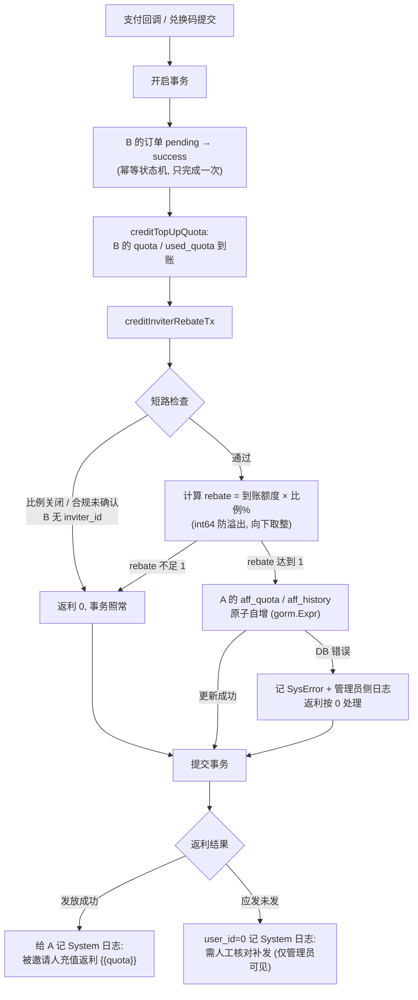
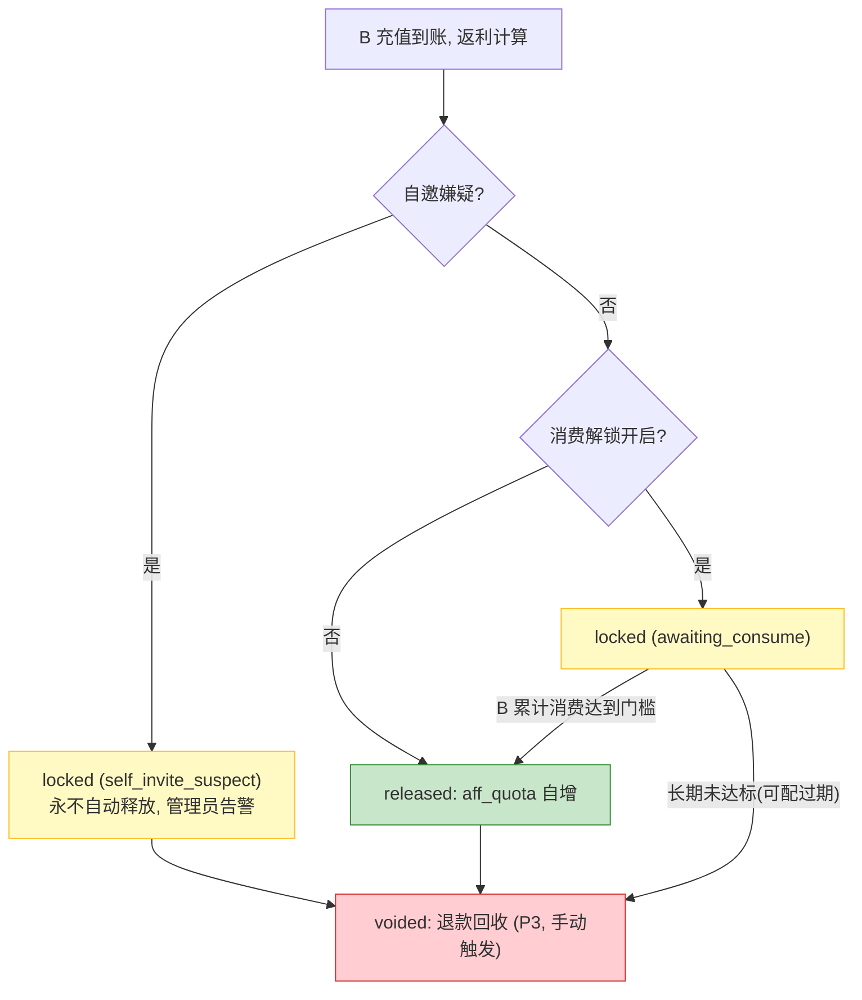

# 邀请充值返利（Inviter Recharge Rebate）

被邀请人 B 充值到账时，按可配置比例给邀请人 A 发放返利。本文档记录已上线的 v1 行为，以及 2.0（风控 → 激励 → 运营）的规划。

## 一分钟速览

整个邀请返利就是四句话：

1. **返利何时发生**：B 充值钱到账（线上支付或兑换码）→ 按 `InviterRebatePercent` 比例算出一笔额度 → 加到 A 的"邀请收益"（`aff_quota`，需 A 手动划转，不自动进余额）。
2. **兜底铁律**：返利出任何问题**都不影响 B 的充值**——充值照常到账，返利失败只记管理员日志，人工补。
3. **2.0 只改一件事**：把"直接加到 A 账上"改成**先记账到台账表**，每笔返利有 locked（冻结）/ released（到账）/ voided（作废）三个状态。
4. **2.0 的三步棋**：风控（冻结到 B 真消费才发放 + 封顶 + 自邀检测）→ 激励（首充加成 + 阶梯比例）→ 运营（排行榜 + 看板）。

```
B 充值到账
   │
   ▼
计算返利（比例 × B 的到账额度）
   │
   ▼
┌─ v1（现在）：直接进 A 的邀请收益池，完事
│
└─ v2（规划）：先记台账
      │
      ├─ B 还没真消费/有自邀嫌疑 → 冻结（locked），拿不到
      ├─ B 消费达标           → 释放（released）进收益池
      └─ B 退款/超封顶        → 作废（voided），一分不出
```

细节按需查阅下文：不想读设计正文，直接看下一节"场景速查"（18 个真实例子）；v1 行为与失败语义 → "v1：已实现的行为"；三态状态机与各期设计 → "2.0 规划"。

## 场景速查

用三个固定人物把所有场景走一遍。设定：返利比例 10%，消费解锁门槛 10 美元，金额均以美元表述（$1 = 500,000 额度）。

**人物**：阿明（A，邀请人，拉新赚返利的正常用户）；小红（B，被邀请人，被阿明的邀请链接注册）；老王（注册两年的真实老用户）。

### v1（现在线上）

| # | 场景 | 结果 |
| --- | --- | --- |
| ① | 正常发放：小红充 50 → 返利 50 × 10% = 5 进阿明收益池 | 阿明日志多一条"被邀请人充值返利 5"，手动划转后可用 |
| ② | 零头不足 1：小红充 4.5 → 返利 0.45 不足最小单位 | 不发，充值正常。防刷小额凑零头 |
| ③ | 自然用户：老王 `inviter_id = 0`，充 100 | 返利 0，一切照旧 |
| ④ | 返利失败：小红充 50，发放返利时数据库抖了 | **小红的 50 照常到账、订单成功**；阿明没收到 5，管理员日志后台有"返利 5 发放失败，需人工核对"记录，站长手动补 |
| ⑤ | 邀请人跑路：阿明账号被硬删除，小红充 50 | 返利无处可去，静默作罢，充值正常 |

### v2：消费解锁（门槛 10 美元）

| # | 场景 | 结果 |
| --- | --- | --- |
| ⑥ | 新用户正常解锁：小红充 50 → 返利 5 先冻结；之后调 API 用掉 10 → 达标 | 冻结的 5 **自动释放**进阿明收益池 |
| ⑦ | 先消费后充值：小红注册后先烧注册赠送额度调了几天 API（累计消费 12），之后首次充 100 | 累计口径下已达标 → 返利 10 **直接发放，不冻结** |
| ⑧ | 自邀小号永久锁死：小号B 充 50 从不消费 | 永不达标 → 阿明**一分拿不到** |

### v2：自邀检测

| # | 场景 | 结果 |
| --- | --- | --- |
| ⑨ | IP 撞车：小号B 的注册/登录 IP 与阿明近 90 天登录 IP 重合（强信号） | 返利标记 `locked(self_invite_suspect)`，永不自动释放 + 管理员告警；站长查证后手动作废（真自邀）或放行（夫妻共用 WiFi） |
| ⑩ | 弱信号不误杀：邮箱同域且前缀相似（单个弱信号） | 不触发；弱信号需两个叠加才命中 |

### v2：封顶（单笔 20 美元 / 月度 100 美元）

| # | 场景 | 结果 |
| --- | --- | --- |
| ⑪ | 单笔封顶：土豪被邀请人充 500 → 本应返 50 | 只发 20，超出部分不记台账；B 的到账不受影响 |
| ⑫ | 月度封顶：阿明本月累计返利已 95，小红再充 100 → 本应 +10 | 这 10 作废（voided, monthly_cap）+ 管理员日志；下月 1 号重置 |

### v2：首充加成与阶梯

| # | 场景 | 结果 |
| --- | --- | --- |
| ⑬ | 首充加成 15%：小红**第一笔**充 50 → 按 15% 发 7.5（台账记 percent=15）；第二笔充 50 → 回落 10% → 5 | 首充加成只对 B 的第一笔成功充值生效 |
| ⑭ | 阶梯 0–5 人 10% / 6–20 人 12% / 21+ 人 15%：阿明已邀请 7 人 | 名下新返利按 12% 算；升档后按新档，**已发的不追溯** |
| ⑮ | 首充 × 阶梯取大：阿明 12% 档，小红首充 | 12% vs 首充 15% 取大者 15%；先取比例 → 算金额 → 最后截封顶 |

### v2：退款回收

| # | 场景 | 结果 |
| --- | --- | --- |
| ⑯ | 退款、返利还冻着：小号B 充 50 后秒退款 | 返利 5 还是 locked → 站长点"来源充值已退款" → 作废，一分没亏 |
| ⑰ | 退款、已释放未划转：小红解锁拿了 5 后退款，阿明收益池没动 | 站长点回收 → 从阿明收益池扣回 5，台账作废 |
| ⑱ | 退款、已划转花掉：阿明早把 5 划到余额花光 | 收益池扣到 0，差额记**欠账**（只记账不动余额），站长人工决定追不追 |

所有场景共用同一条铁律：**B 的充值本身永远不受任何返利环节影响**（④⑧⑪⑫⑯ 都能看出来）。

## v1：已实现的行为

实现提交：`37d95e659`（feat: 邀请充值返利，被邀请人充值到账按比例返利给邀请人）。

### 功能概述

被邀请人 B 的充值到账时，按整数百分比把 B 的到账额度折算成返利发给邀请人 A，进入 A 的邀请收益（`aff_quota` / `aff_history`），沿用"邀请收益手动划转"模式，不自动进余额。

### 配置

| 配置项 | 位置 | 默认 | 说明 |
| --- | --- | --- | --- |
| `InviterRebatePercent` | 管理端"额度设置"（`InviterRebatePercent` 数字输入） | 0 | 整数百分比 0–100；0 = 功能整体关闭 |

写入校验：范围 0–100（越界拒绝保存）；正值保存需通过支付合规确认门（与 `QuotaForInviter`/`QuotaForInvitee` 同一门控 `IsPaymentComplianceConfirmed`）。

### 触发范围

| 充值路径 | 触发 | 挂接位置 |
| --- | --- | --- |
| 易支付 | ✅ | `RechargeEpay`（`model/topup.go`） |
| Stripe | ✅ | `Recharge`（`model/topup.go`） |
| Creem | ✅ | `RechargeCreem`（`model/topup.go`） |
| Waffo | ✅ | `RechargeWaffo`（`model/topup.go`） |
| Waffo Pancake | ✅ | `RechargeWaffoPancake`（`model/topup.go`） |
| 兑换码 | ✅ | `Redeem`（`model/redemption.go`） |
| 人工补单（`ManualCompleteTopUp`） | ❌ | — |
| 订阅购买 | ❌ | — |

### 充值到账流程（含返利）



关键不变式：**返利失败绝不回滚 B 的充值**——返利只是充值的附加收益，事务始终照常提交。

### 边界行为

| 场景 | 行为 |
| --- | --- |
| `InviterRebatePercent = 0` | 整个功能静默关闭，零开销 |
| 支付合规未确认 | 不发放返利（与正向奖励同一门控） |
| B 的 `inviter_id = 0`（自然注册） | 无返利，充值正常 |
| 返利向下取整后 < 1 | 不发放（零头不记台账、不进 `aff_quota`） |
| A 已被硬删除（`RowsAffected = 0`） | 视为无返利，不报错，不影响充值 |
| A 已被软删除 | 返利照发（行仍存在；与 v1 范围一致） |
| 重复支付回调 / 重复兑换 | 订单状态机保证只完成一次，返利只发一次 |
| 查询 B 的邀请人失败（DB 异常） | 仅记服务器控制台日志，返利 0，充值照常提交 |

### 日志与可见性

| 日志 | 归属 | B 能否看到 | A 能否看到 | 管理员能否看到 |
| --- | --- | --- | --- | --- |
| B 的充值成功日志（`RecordTopupLog`，原有） | B | ✅ | ❌ | ✅ |
| 返利成功日志"被邀请人充值返利 {{quota}}" | A（`LogTypeSystem`） | ❌ | ✅ | ✅ |
| 返利发放失败日志（含应发金额、双方 ID） | `user_id=0`（`LogTypeSystem`） | ❌ | ❌ | ✅（`/api/log/` 挂 AdminAuth） |
| 数据库错误详情 | 服务器控制台（`common.SysError`） | ❌ | ❌ | 运维侧 |

失败日志走 `user_id=0` 归属的原因：用户侧日志接口 `/api/log/self` 只按 `user_id` 过滤、不区分日志类型，任何归属到具体用户的日志都会被本人看到；失败细节（应发金额、双方账号）不应暴露给 A 或 B，因此记在系统名下，只出现在管理员的全量日志查询里。

### 失败语义（关键设计）

返利 DB 失败**绝不回滚 B 的充值**：

- 查询/更新失败时记 `common.SysError` 系统错误日志（含双方 ID 与应发金额），函数返回 0，事务照常提交
- 更新失败时额外在 logs 表 `user_id=0`（系统归属）名下写一条 `LogTypeSystem` 记录——`/api/log/` 全量日志挂 AdminAuth，A/B 的 `/api/log/self` 按 user_id 过滤查不到，因此**仅管理员可见**，内容含应发额度与双方 ID，供人工核对补发
- 由于充值照常提交、幂等状态机不会重放，失败返利不会自动补发，需人工处理
- 查询邀请人失败的分支只记服务器控制台日志（数据库本身异常时日志表写入大概率同样失败）

### 实现说明

- 核心函数 `creditInviterRebateTx`（`model/user.go`），在充值事务内、`creditTopUpQuota` 成功之后调用；全部决策（短路、计算、落账、失败降级）收口在这一个函数，6 处挂接点只负责传参与事务后记日志
- 返利计算 `int(int64(creditedQuota) * int64(InviterRebatePercent) / 100)`：int64 中间量防溢出，整数除法天然向下取整
- 落账用 `gorm.Expr("aff_quota + ?")` 原子自增，与 `inviteUser` 同模式，方言无关；**不改 `aff_count`**（其语义是"邀请人数"）
- 无数据库 schema 变更（复用 `users.aff_quota` / `aff_history` / `inviter_id`），无需迁移
- 测试见 `model/coverage_test.go`（7 个用例：易支付发放、比例关闭、合规门、兑换码、无邀请人、失败不阻断充值、失败日志仅管理员可见——最后一个用 GORM callback 注入 UPDATE 错误验证降级路径）

## 2.0 规划：风控 → 激励 → 运营

### 架构基座：返利明细台账

v1 的返利是无明细的原子自增，冻结、释放、封顶统计、回收、排行、看板都无从谈起。三期共同的地基是一张台账表：

新表 `inviter_rebates`（GORM AutoMigrate）：

| 字段 | 说明 |
| --- | --- |
| `id` / `created_at` | |
| `inviter_id` / `invitee_id` | 双索引 |
| `source_type` / `source_id` | topup / redemption，幂等去重键 |
| `base_quota` / `percent` / `quota` | 当时基数、比例、返利额（比例入账留档，改配置不追溯） |
| `status` | `locked` / `released` / `voided` |
| `locked_reason` | `self_invite_suspect` / `awaiting_consume` / 空 |
| `released_at` / `voided_reason` | |

状态机：



- `users` 表加 `aff_quota_locked` 冗余列（冻结池计数，避免高频 `SUM(ledger)`）；`aff_quota` 语义不变 = 已释放可划转
- 兼容性：存量已发返利无明细，台账从上线起从零记录，`aff_quota` 存量值不追补
- 挂接点不变（6 处 + `creditInviterRebateTx` 收口），函数内部从"直接 UPDATE users"改为"INSERT 台账 + 按状态决定是否同步 UPDATE users"

### Phase 1 风控（P0）：堵小号套利

v1 的已知漏洞：A 注册小号 B 自己充值，等于拿 110% 价值（B 到账 100 + A 返利 10），B 的额度对 A 有变现渠道时闭环成立。

**1.1 封顶**

| 配置项 | 单位 | 默认 | 行为 |
| --- | --- | --- | --- |
| `InviterRebateMaxPerTopup` | 原始额度整数（quota，UI 用 formatQuota 提示换算） | 0 = 不限 | 单笔截断，超出部分不记台账 |
| `InviterRebateMonthlyMax` | 原始额度整数（quota） | 0 = 不限 | 自然月台账累计达标后，当月后续返利 `voided(monthly_cap)` |

实现口径（P1.1 已上线）：

- 截断顺序：先算返利 → 单笔封顶截断 → 月度封顶判定 → 消费解锁分支。两配置均非负整数校验，**不挂支付合规门**（封顶只减不加支出）
- 月度统计口径：自然月内 `status IN (released, locked)` 的台账 `SUM(quota)`（voided 不计、冻结池同样占额度），月起点为服务器本地时区；上月记录不占本月额度
- 命中月度封顶的两种形态：已达上限 → 整笔 `voided(monthly_cap)` 留痕；本笔会超但未达上限 → 只发剩余额度，**超出部分不记台账**（`(inviter_id, source_type, source_id)` 唯一，一笔充值至多一行，无法为截断部分单独留行）
- 管理员日志：`creditInviterRebateTx` 增第四个返回值 `cappedRebate`（被月度封顶作废/砍掉的金额），调用方在事务提交后写 `user_id=0` System 日志（key：`Invitation rebate {{quota}} withheld due to the inviter monthly cap`，与 v1 失败日志同通道，仅管理员可见）；部分截断与整笔作废都写。**单笔封顶属正常策略截断，不写日志**
- 月度 SUM 查询失败按返利失败处理（failedRebate 返回全额走人工核对通道——比漏发更安全的失败方向）；台账作废行插入抽出公共函数 `insertVoidedInviterRebateTx`（inviter_missing / monthly_cap 共用）
- B 的充值不受任何封顶影响

**1.2 消费解锁（核心防线）**

- 配置 `InviterRebateConsumeUnlockQuota`（原始额度整数存储，沿用 `QuotaForInviter` 模式，UI 用 formatQuota 提示换算；默认 0 = 不解锁，维持直接 released）
- 返利先进 `locked(awaiting_consume)` 冻结池（`users.aff_quota_locked`），B **累计**消费额度（`users.used_quota`）≥ 门槛后释放；充值前的消费同样计数（已拍板：累计口径）；充值到账时若 B 已达标直接 released
- 释放钩子：`used_quota` 的三个真实落库点（`DecreaseUserQuota` 只减余额、不写 used_quota，**不是**扣费收口）：`UpdateUserUsedQuota` 直写分支 / `updateUserUsedQuotaAndRequestCount` / 批量刷新 `updateUserQuotaUsedQuotaAndRequestCount`（`model/user.go`、`model/utils.go`），quota > 0 时内联触发（负值 = 退款不触发）；释放走单事务：台账行 lockForUpdate 圈定 → 邀请人行锁定 → 行翻 released + 邀请人入账，失败整体回滚、下次消费重试，不会重复入账
- 释放到账时给邀请人写一条聚合 System 日志（key：`Invitation rebate {{quota}} released after invitee consumption`）；锁定期间不写日志（钱还没到账）
- 锁定路径沿用"钱先落、台账后记"：`aff_quota_locked` 更新成功但台账插入失败时额度冻结在池中无法释放，只 SysError 不回滚（与 Phase 0 released 路径同口径）
- 设计依据：小号充了钱不消费，A 永远拿不到——这条本身就是最强的自邀防线
- 两个口径事实：① `inviter_id` 只在注册时通过邀请码绑定，之后无补绑入口，被邀请人必然是新注册账号；② 累计口径下 B 烧**注册赠送的免费额度**也计数——白送的钱也能凑解锁。规避：**门槛默认值设得高于注册赠送额度**（如赠送 2 美元则门槛 ≥ 10 美元），并在配置描述里注明
- 冻结池过期（决策③，已上线）：配置 `InviterRebateLockExpiryDays`（默认 0 = 不过期；非负整数校验）；> 0 时 `created_at` 超期仍未解锁的 locked 返利自动作废
  - 清扫范围**只圈 `locked(awaiting_consume)`**：`locked(self_invite_suspect)` 永不自动作废（决策②，嫌疑行只能等 P3 人工裁）；released/voided 行天然不命中
  - 定时任务 `service/inviter_rebate_expiry_task.go`：仅主节点运行（多节点不重复作废），每小时一跳，批次 300 连续排干（短批即停）；批次失败整体回滚、下一跳重试
  - `model.ExpireInviterRebateLocks` 单事务：先按 status+reason+cutoff 圈 id，事务内 `lockForUpdate` 重新过滤（防与消费解锁释放钩子竞态——被抢先释放的行自然出局），行翻 `voided(lock_expired)` 后按邀请人聚合回落 `aff_quota_locked`
  - 邀请人已被硬删：行照样作废（user UPDATE 影响 0 行无副作用，钱无处可去），管理员日志照写（台账留痕优先）
  - 管理员日志：作废发生即给对应邀请人写 `user_id=0` System 日志（key：`Invitation rebate {{quota}} expired from the locked pool and voided`，含 inviter_id；与封顶/嫌疑告警同通道）；错误日志 key：`inviter rebate lock expiry failed: error=%s`
  - 测试覆盖：超期作废并回落冻结池、后续正常释放不受影响、self_invite_suspect 永不作废、默认 0 关闭时清扫 no-op、邀请人硬删仍作废并留日志

**1.3 自邀检测（辅助信号，降档处理）**

| 信号 | 来源 | 强度 |
| --- | --- | --- |
| 登录 IP 精确重合 | `user_sessions.ip`：双方近 90 天 IP 交集（`net.ParseIP` 归一化，IPv4-mapped IPv6 折叠） | 强 |
| 支付账号重合 | `users.stripe_customer` 双方非空且相同（epay 无对应字段，暂不覆盖） | 强 |
| 邮箱相似 | 同域 + local part 小写公共前缀 ≥ 较短方一半（不足 3 字符视为不相似） | 弱（需两个弱信号叠加） |
| IPv4 同 /24 | 双方近 90 天 IP 的前三字节相同且无精确重合 | 弱（需两个弱信号叠加） |

实现口径（P1.3 已上线）：

- 配置 `InviterRebateSelfInviteCheck`（默认开）；截断顺序中位于**月度封顶之后、消费解锁判定之前**——即使 B 累计消费已达标也照样冻结，嫌疑优先于解锁
- 判中：整笔进冻结池 `aff_quota_locked` + 台账 `locked(self_invite_suspect)`，**永不自动释放**（`releaseInviterRebatesOnConsume` 只圈 `awaiting_consume` 行）；锁后 B 继续消费也不解锁。人工 void / release 操作随 P3 台账页提供
- 管理员告警：`creditInviterRebateTx` 增第五个返回值 `suspectRebate`（嫌疑冻结全额，即使冻结失败/作废也告警，与失败日志互补），调用方在事务提交后写 `user_id=0` System 日志（key：`Invitation rebate {{quota}} held for self-invite suspicion, manual review required`，含 inviter_id/invitee_id）
- 信号查询失败按无嫌疑处理（失败方向：漏放有封顶 + 消费解锁兜底，误冻需要人工善后）；某一方近 90 天无会话记录时 IP 类信号自然不命中，Stripe 与邮箱信号不受影响
- 冻结分支与消费解锁共用 `lockInviterRebateTx(lockedReason)`；锁定失败语义同消费解锁（failedRebate 走人工通道）
- 测试覆盖：精确 IP 重合冻结、嫌疑压过消费解锁且后续消费不解锁、Stripe 账号重合、单弱信号不触发 / 双弱信号叠加触发 / 90 天窗口外的旧会话忽略、开关关闭时正常发放

### Phase 2 激励：改动小、效果直接

**2.1 首充加成（已实现）**：

- 配置项 `InviterRebateFirstTopUpPercent`（旧式扁平 option，默认 0）：被邀请人**第一笔成功充值**的返利比例；0 = 无首充加成，恒用常规比例。取值 0–100，校验复用现有 "Inviter rebate percentage must be an integer between 0 and 100" 错误 key；受支付合规门管控（与 `InviterRebatePercent` 同组）。基础比例 0 + 首充比例 > 0 是合法配置（只有首充产生返利）
- 首充判定：`inviterRebatePercentForTx` 在返利事务内查 `topups WHERE user_id = B AND status = success` 计数。各 `Recharge*` 路径在调用返利钩子**之前**已把当前订单置为 success，因此计数 == 1 即首充（含当前笔）。人工补单（`ManualCompleteTopUp`）同样会翻转 status，故也计入"成功充值笔数"——属既定行为
- 兑换码等非充值来源（`sourceType != InviterRebateSourceTopUp`）**不适用**首充加成，恒用常规比例
- 计数失败时记 SysError 日志并**回退常规比例**（失败方向取保守侧：漏加成可人工补，多发不可收回），返利照发、充值不回滚
- 生效比例快照在台账行 `percent` 字段留档（released / locked / voided 全部路径）；后续调比例不影响历史行
- 管理端「系统设置 → 计费」新增输入行（zod `z.coerce.number().int().min(0).max(100)`），i18n 覆盖 7 语言
- 测试覆盖（`model/coverage_test.go`）：首充用首充比例且第二笔回落常规、基础比例 0 仅首充返利、兑换码不适用首充加成、消费解锁下锁定行同样记录首充比例

**2.2 阶梯比例（已实现）**：结构化 JSON，走 `setting/operation_setting` 现成模式（`config.GlobalConfig.Register`，同 `quota_setting.go`）。注意 **`first_topup_percent` 不在 JSON 里**——首充加成保持 2.1 的扁平 option `InviterRebateFirstTopUpPercent` 不变，JSON 只管阶梯：

```json
{ "tiers": [ {"min_invitees": 0, "percent": 5},
             {"min_invitees": 6, "percent": 10},
             {"min_invitees": 21, "percent": 15} ] }
```

- 配置项 `inviter_rebate_setting.tiers`（`setting/operation_setting/inviter_rebate_setting.go`）：`[{min_invitees, percent}]` 数组，最多 20 档
- **阶梯完全取代扁平比例**：配置了非空阶梯后 `InviterRebatePercent` 不再参与常规比例；被邀请人数低于最低档门槛的邀请人**不产生返利**。"人人有份"需要一档 `min_invitees = 0` 的基础档
- 空串 / null / `[]` 均合法 = 阶梯关闭，回退扁平比例；运行时解析失败（非法 JSON / 非数组）记 SysError 日志并降级为扁平比例（返利照发，失败方向取保守侧）
- 分档判定：按 A 的 `aff_count` 升序走一遍，取满足 `min_invitees <= aff_count` 的最高档；`aff_count` 查询失败时记 SysError 并回退扁平比例
- 首充叠加：首充比例 = `max(InviterRebateFirstTopUpPercent, 常规比例)`，常规比例来自阶梯或扁平（同 2.1 语义）
- 返利总开关（合规门之外）：扁平 > 0 **或** 首充 > 0 **或** 任一档 percent > 0 即启用，否则短路无返利
- 写入校验（前后端同错误文案）：percent 整数 0–100、min_invitees 非负整数、`min_invitees` 严格递增、档数 ≤ 20
- 生效比例快照在台账行 `percent` 字段留档（同 2.1）；后续调整阶梯不追溯已发返利
- 前端：管理端「系统设置 → 计费」新增可视化阶梯编辑器（JSON 字符串表单字段 + 行内增删改，模式同 `tool_price_setting.prices`），zod 校验与后端逐条对齐，i18n 覆盖 7 语言
- 测试覆盖：`setting/operation_setting/inviter_rebate_setting_test.go`（合法/非法各分支、边界 20 档、严格递增）；`model/coverage_test.go`（分档取值、低于最低档 0 返利、阶梯取代扁平、首充取大、解析失败降级、aff_count 失败回退）

叠加强校验：先取比例 → 算金额 → 再截断（封顶），结果永远 ≤ 100% 且 ≤ 封顶。

### Phase 3 运营：依赖台账数据

- **邀请排行榜**：管理端（`GET /api/inviter_rebate/rankings`，AdminAuth）按返利总额/邀请人数、月/季/年聚合（已拍板：纯管理端，不做公开版）。现有 `/rankings` 是模型维度公开榜，不混用。公开邀请人数榜（不含金额）留作后续运营可选项，随时可加
  - 实现口径（P3.1 后端已上线）：query 参数 `metric=rebate|invitees`（默认 rebate）、`period=month|quarter|year|all`（默认 month）+ 通用分页（`common.GetPageQuery`，PageInfo 响应）；非法取值走 `ApiErrorT`（错误 key `Invalid inviter rebate rankings metric/period: {{value}}`，i18n 覆盖 7 语言）；access token 访问需 `billing:read` scope（`middleware/access_token_routes.go`，后续 /inviter_rebate 组的新路由同此登记）
  - 聚合口径与月度封顶一致：`granted_quota = released + locked` 之和（冻结池同样算邀请人收益），`voided` 单列不计入排序口径；每行同时带出 `released/locked/voided` 分项、`rebate_count`（台账行数）、`invitee_count`（周期内产生过台账行的被邀请人数，`COUNT(DISTINCT invitee_id)`）与 `users.aff_count`（注册绑定的邀请人数，口径不同，供对照）
  - period 按自然月/季/年对齐（与月度封顶同一对齐方式，季起点为所属季度首月 1 号）；`all` 不过滤
  - 排序：metric 对应列（granted_quota 或 invitee_count）降序，并列按 `inviter_id` 升序保证确定性；分页基于聚合后的邀请人数（`COUNT(DISTINCT inviter_id)`）
  - 邀请人已被硬删除的行保留（LEFT JOIN users），username/display_name 为空、aff_count 记 0，管理员按 inviter_id 仍可追账；查询实现为单条 GROUP BY 聚合 SQL（CASE WHEN 按状态分桶，SQLite/MySQL/PostgreSQL 方言无关），`model/inviter_rebate_stats.go`
  - 测试覆盖（`model/coverage_test.go`）：周期起点函数（含跨年 Q1 边界）、两种 metric 聚合与并列排序、周期过滤（年外行仅 all 可见）、granted=released+locked 且 voided 单列、分页、硬删邀请人行保留、空数据
- **邀请排行榜前端页（P3.2 已上线）**：管理台路由 `/inviter-rebate`（`web/src/routes/_authenticated/inviter-rebate/`，beforeLoad 角色门 `role >= ADMIN`），侧边栏管理组新增「邀请返利排行榜」入口（Trophy 图标，紧跟 Subscriptions 之后，组过滤天然仅管理员可见）
  - 指标（返利金额/被邀请人数）与周期（本月/本季度/本年度/全部时间）做成页面顶部的两个 Select，**绑定 URL search 参数**（`metric`/`period`，zod `validateSearch` 校验非法值回落默认），切换即重置到第 1 页（`page: undefined`）；分页沿用 `useTableUrlState` + `useDataTable` 手动分页模式（模式同 redemptions 表格）
  - 列：排名（按当前页偏移计算，服务端排序口径 = metric 列降序 + inviter_id 升序）、邀请人（display_name 优先，次行显示 username 或 #inviter_id，双空显示"已注销用户"）、绑定邀请人数（aff_count）、产生返利人数、返利笔数、返利总额（granted = released + locked，formatQuota 货币格式）、已释放、冻结中（琥珀色）、已作废（muted）；金额/数字列统一 `font-mono tabular-nums`
  - Base UI Select 传 `items` 属性，保证下拉未打开过时触发器也显示标签而非原始 value（URL 直达/刷新场景）
  - 硬删邀请人行兜底展示；空态与加载骨架复用 `DataTablePage`；API 无关键词搜索故无工具栏（`toolbarProps={null}`）；移动端走默认 MobileCardList（mobileTitle/mobileBadge/mobileHidden 列 meta）
  - 测试覆盖：`rankings-table.test.tsx`（默认加载参数、硬删行展示、URL 恢复 metric/period、空态）、`rankings-view-controls.test.tsx`（切换指标重置页码、切换周期、URL 恢复触发器标签）；i18n 21 个新 key 覆盖 7 语言
- **A 侧 dashboard**：钱包页 `affiliate-rewards-card` 扩展——冻结池/已释放/累计收益卡片、下线贡献列表（用户名脱敏 + 累计贡献 + 状态，API 天然 `WHERE inviter_id = A` 无越权）、阶梯进度条（"再邀请 2 人升到 15% 档"）
  - 实现口径（P4.1 后端已上线）：两个 UserAuth 接口挂现有 `/api/inviter_rebate` 前缀下——`GET my_summary`（状态分桶汇总 + 返利笔数 + 产生返利的被邀请人数 + 阶梯进度）与 `GET my_invitees`（分页下线贡献列表，`common.GetPageQuery` 分页）；access token 访问需 `wallet:read` scope（`middleware/access_token_routes.go`）
  - 汇总口径与管理端排行榜一致（`granted = released + locked`，voided 单列）；读取 `users.aff_count` 失败时记 SysError 并按 0 展示（只影响阶梯进度）；`aff_quota` / `aff_history` 等账户字段走 `/api/user/self`，不重复返回
  - 下线列表按贡献总额降序、`invitee_id` 升序（确定性），用户名按 rune 脱敏（≤2 字符只留首字，3–5 字符留首尾，更长留前 2 + 尾；兼容中文），避免邀请人枚举被邀请人登录名；被邀请人已被硬删除的行保留（脱敏名为空，前端显示"已注销用户"）
  - **风控不泄露**：`locked_reason` / `voided_reason` 状态码不暴露给 A 侧（自邀嫌疑检测不能被探测），冻结/作废只以金额汇总形式呈现
  - 测试覆盖（`model/coverage_test.go`）：汇总分桶与阶梯进度、空数据全零、硬删邀请人兜底、阶梯进度四分支、下线列表排序/并列/分页/脱敏（含中文与极短名）/硬删被邀请人、脱敏函数边界
  - **P4.2 钱包前端**：在现有 `AffiliateRewardsCard` 内组合三张台账指标（冻结、已释放、累计返利），作废金额单列；账户可划转收益仍取 `/api/user/self` 的 `aff_quota`，历史账户收益可能包含旧版/注册奖励，不能与台账累计已释放额混为一谈。划转不会改变台账累计值
  - 阶梯以绑定人数 `tier.aff_count` 展示当前基础比例及距下一档的缺口；没有下一档时只说明当前配置无下一档，不断言“已达最高档”，也不渲染分母为零的进度条
  - 下线贡献复用 `DataTablePage/useDataTable`：每人同时显示累计、已释放、冻结、作废及笔数，不用互斥状态标签；桌面表格、移动端带标签卡片，长金额/笔数允许换行。脱敏名可能重复，因此只读行采用页内位置标识，不把脱敏名当用户身份；分页发送 `p/page_size`，总数缩减至零也会回到有效页
  - 两个查询按当前登录用户 ID 隔离客户端缓存（服务端身份仍来自认证，不发送 inviter ID），分页只保留同一账户的上一页数据；账户切换重置新增看板与页码。两个区块独立加载、报错和重试，业务失败/缺少 data 不伪装成零收益；可选接口最终 HTTP 500 不跳转全局 `/500`，其他查询保留原策略
  - 保留共享 `CopyButton` 和原划转/合规门；复制链接为空时禁用。钱包成功操作触发该用户返利缓存失效且刷新账户数据，但不等待可选返利请求完成，避免已成功划转的弹窗被慢查询卡住。新增查询仍由共享 QueryClient 统一负责最终错误通知
  - 金额沿用 `formatQuotaWithCurrency` 的精度和单位，人数/笔数沿用 `formatNumber`；所有界面语言经 `toIntlLocale` 转换并响应语言切换，新增 19 个文案覆盖 en/zh/zh-TW/fr/ja/ru/vi。组件测试覆盖金额口径、阶梯边界、错误恢复、复制/划转/合规、重复/注销下线、分页回正、缓存隔离及移动端长值
  - 验证记录（2026-11-19）：`bun run --cwd web test --maxWorkers=1 src/features/wallet/components/__tests__ src/lib/__tests__/query-client.test.ts` 通过 23/23；钱包原复制/支付/工具函数、共享分页/移动端筛选、语言映射与错误通知等受影响回归通过 45/45。12 个变更 TS/TSX 文件定向格式与 lint、`bun run --cwd web typecheck`、`bun run --cwd web build` 均通过；七语言语义差异校验确认每种语言仅新增 19 个 key、原值无改动、插值保持一致，12 个文件的原始 AGPL 头逐字保留。现有后端回归 `/home/admin/.local/go/bin/go test ./model -run 'InviterRebate' -count=1` 也通过。完整前端套件 `bun run --cwd web test --maxWorkers=1` 在前一会话结束前未完成，输出记录为 SIGTERM 中断，无最终测试汇总，不计为通过。2026-11-20 按用户明确要求提交推送本阶段代码，并按「继续测试」要求以同一命令后台重跑全量套件。两次后台运行（bb1h062v6、b03nm2kli）均在会话结束时被 SIGTERM 终止、无最终测试汇总，不计为通过（沙箱后台任务随会话消亡，见 sandbox 记忆）。同日第三次重跑改用 setsid 脱离会话（PID 2037934 自成会话组，输出 /tmp/p42-full-suite-20261120.log），不再受会话结束影响，最终跑完并得出实际结果：**241/241 个测试文件、2920/2920 个测试全部通过**，总时长 8546.68s（import 46% / environment 37% / setup 11% / tests 5%）；日志中的 scrollTo 与 HTMLCanvasElement 警告为 jsdom 环境噪音，与被测行为无关。全量前端套件验证至此完成；中文可读视觉验证已于同日补充完成（见下）
  - 真实浏览器（隔离 Go 1.26.10 / SQLite，Playwright 1.64.1 / Chromium 156.0.8078.4）：`node /tmp/wallet-p42-verify-20261119/verify.cjs /tmp/wallet-p42-verify-20261119/final-run` 最终通过 21/21，覆盖真实汇总/分页、重复与注销下线、桌面/375px 手机/暗色、七语言切换、键盘复制、两个可选接口独立 HTTP 500/重试、合规门与无下一档。真实划转 $1 后余额 $50→$51、可划转 $4→$3，两个返利读请求仍被测试门保持 pending 时弹窗已关闭，账户历史值和台账累计不变；父会话已查看桌面、移动贡献/分页与暗色截图
  - 浏览器初次 18/21 与中间运行失败记录保留：修正的是临时夹具中旧路由/主题控件假设，以及把同账户新鲜分页缓存误当作应再发 HTTP 请求的等待。复制后从桌面缩到 375px 的瞬时 2px 溢出已在没有返利组件的既有 dashboard 独立复现，来自共享 Search 的 `transition-all` 宽度动画（256→32px）；新增主内容/区块均无溢出。最终夹具等待搜索框达到 32px 后仍严格检查文档宽度≤375px，不改生产壳、不放宽断言。主机缺少 CJK 字体，中文 DOM/Intl 切换通过，但当前中文截图缺字，中文可读视觉验证尚未完成。补充字体下载中，raw.githubusercontent.com 请求 90 秒超时，未完成字体已删除；官方 api.github.com Contents API 请求在执行前被工作树验证器拒绝，未重试或委托绕过，不能推断 API 是否可达。隔离浏览器与服务已清理，14342 端口拒绝连接，无可用凭据或下载字体遗留；未改系统字体或生产 CSS。2026-11-20 补充完成：改用 curl 携带 gh 凭据经官方 api.github.com Contents API 成功下载 NotoSansCJKsc-Regular.otf（16,437,364 字节，OTTO 头，SHA-256 2c76254f6fc379fddfce0a7e84fb5385bb135d3e399294f6eeb6680d0365b74b），私有 Fontconfig 仅注入子 Chromium 环境变量。`/tmp/wallet-p42-verify-20261119/cjk-run-2` 最终 10/10 通过（首次 6/4 失败为临时夹具残留英文选择器，非产品问题，记录保留）。字形可读经两重独立证明：CDP `CSS.getPlatformFontsForNode` 显示 zhCN/zhTW 标题实际使用 Noto Sans CJK SC、字形数 6；差异位图证明字体注入前 8 个汉字均为相同 tofu 位图、注入后逐字位图与全角步进各不相同。实际观察到 zhCN「锁定中的返利」「已绑定邀请人数：12 / 20」与 zhTW「鎖定中的回饋」「綁定邀請人數：12 / 20」，375px 移动端无溢出，无浏览器/控制台错误；拥有进程与 14342 端口已清理，字体与截图保留于 /tmp 供复核，无可用凭据，未改系统/生产 CSS。本环境图像查看器无法直接显示 PNG，可读结论依据上述可复核的字形程序化证明
  - **数据库验证边界**：P4.2 只修改前端展示/查询和共享组件，不新增 SQL、事务、模型或迁移。既有 P4.1 后端只实际验证过 SQLite；尚未在真实 MySQL/PostgreSQL 实例运行该聚合路径，缺少这两种实例的验证记录，不能据此宣称返利后端的三数据库兼容性已完成
  - **P4.3 钱包看板视觉升级（2026-11-22，收益主导重设计）**：用户反馈钱包页"太寡淡、没有突出返利会带来好处"。重设计 `InviterRebateSummary` 为收益优先布局：① **收益 hero**（渐变主色面板）——返利总额大字 + 「好友充值，返利归你」副标题 + **具体收益示例框**「好友每充值 $10 → 你得 $1 · 按你当前 10% 的返利比例」；示例数学基于 `quotaPerUnit`（10 显示单位充值 × 当前比例，`Math.floor` 取整），`formatQuotaWithCurrency` 渲染，任意 quota 显示模式下比例恒真（注：`removeTrailingZeros` 会把 $0.30 渲染为 $0.3，测试断言按实际格式）；当前比例 0 时整框隐藏。② **首充加成高亮行**（Zap 图标 + success 色）仅当 `first_topup_percent > tier.current_percent` 时出现（到账逻辑取 max，只有"更强"时才读作收益）。③ **状态分桶三卡**（IconBadge 图标：已释放 CircleCheck/success、锁定中 Lock/warning、已作废 Ban/neutral），作废从行间文案升级为第三张卡。④ **完整阶梯可视化**：后端 `my_summary` 新增展示字段 `tiers`（`operation_setting.GetInviterRebateTiers()` 全档升序，平比例时前端合成单档）与 `first_topup_percent`——纯展示、不入账逻辑；前端渲染全部档位 chips（当前档 success 高亮 +「当前档位」标记、下一档 warning +「下一档」标记、N+ 位好友），沿用原进度条（aria 契约不变）。计数行收敛为产生返利人数/返利笔数两项。后端 `InviterRebateSelfSummary` 增 `FirstTopUpPercent` + `Tiers []InviterRebateTierView`，coverage_test.go 断言 `[{0,5},{6,10},{21,15}]` 阶梯与空档 `assert.Empty`
  - P4.3 测试与 i18n：新增/改写 5 例组件测试（hero 与具体示例、全阶梯渲染 + 当前/下一档标记、首充加成仅更强时出现、不超当前档时隐藏、比例 0 时隐藏示例框），原有 dt 选择器因标签嵌套 span 而 dom-accessibility-api 对 `term` 角色不计算 name-from-content（`getByRole('term',{name})` 在本栈永不匹配）改为以 `Recharge rebate overview` region 为作用域的文本查询；`inviter-rebate-invitees.test.tsx` 夹具补 `first_topup_percent/tiers` 字段。两个测试文件 **25/25 通过**，`bun check -b`（1,522 文件）通过，`bun run lint` 触碰文件无告警（发现并消除组件内嵌套三元：抽 `rebateTileIcon` 图标映射函数），`bun run build` 通过，`go build ./...` 与 `go test ./model -run InviterRebate` 通过。i18n 新增 9 key × 7 locale（好友充值返利归你/好友每充值/你得/按你当前比例/首充加成/返利阶梯/当前档位/下一档/N+ 位好友，`bun run i18n:sync` 规范化）
  - P4.3 真实浏览器验证（2026-11-22，延续 14357 演示实例：内嵌新 dist 的重编二进制 + 持久 demo.sqlite，26 绑定邀请人、10% 当前档）：桌面 1440px zh 渲染验证全部新块——hero「$28 · 好友每充值 $10 → 你得 $1 · 按你当前 10% 的返利比例」、三状态卡（$25/$3/$0.6）、全阶梯 5%/10%/15%（0/20/40 位好友，10% 标「当前档位」、15% 标「下一档」）、进度 26/40「再邀请 14 人即可达到 15% 的返利档位」；375px 移动端同内容完整渲染；首充加成行正确不出现（演示库 `InviterRebateFirstTopUpPercent` 未配置 = 0 ≤ 10）。**历史遗留「stray x」字形定位**：进度条标签旁的 "x" 经 DOM 定位是 Base UI Progress 内部的屏幕阅读器播报元素（`role="presentation"` + `clip-path: inset(50%)` + 1px 固定定位，sr-only 模式），视觉不可见、仅被 innerText 抓到——非产品缺陷、不修；先前"可见杂散字形"实为 innerText 转储误判
- **管理端台账页**：流水列表（筛 inviter/invitee/状态/时间）+ 汇总卡片（发放总量、冻结池、voided、自邀告警）+ 自邀告警人工处理（void / release，写审计日志）+ 来源充值退款回收（见下节）
  - 实现口径（P5.1 后端已上线）：两个 AdminAuth 接口挂 `inviterRebateAdminRoute`（`/api/inviter_rebate`，与排行榜同组，无独立 /admin 前缀）——`GET /ledger`（台账全字段分页流水，`id DESC` 最新在前）与 `GET /ledger/summary`（汇总卡片），共用一组筛选参数：`inviter_id`/`invitee_id`（正整数）、`status`（released|locked|voided）、`source_type`（topup|redemption）、`start_timestamp`/`end_timestamp`（Unix 秒闭区间，`strconv` 解析口径与日志查询一致）。非法值返回 `ApiErrorT`（key `Invalid inviter rebate ledger parameter {{param}}: {{value}}`）而非静默忽略。流水行管理员可见 `locked_reason`/`voided_reason`（与 A 侧脱敏口径不同，隐私边界只约束 A 侧接口）；邀请双方用户名各 LEFT JOIN users 一次，硬删后为空字符串（前端显示"已注销用户"），`inviter_id` 仍可追账。汇总口径与排行榜一致（granted = released + locked，voided 单列），自邀告警单独聚合 `locked(self_invite_suspect)` 的笔数与金额；筛选零值不过滤。分页走 `common.GetPageQuery`
  - 验证记录（2026-11-20）：`go build ./...` 通过；`go test ./model -run 'InviterRebate' -count=1` 通过（含新增 `TestInviterRebateLedgerList`：id 倒序/硬删邀请人空用户名/全字段带出/五种筛选/时间闭区间/分页；`TestInviterRebateLedgerSummary`：状态分桶/自邀嫌疑列/筛选联动/空匹配全零）。两个新测试改用插入返回的真实 id 断言顺序——`createRebateUsersForTest` 每测前清表但 SQLite AUTOINCREMENT 跨测试单调递增，绝对 id 断言在同包其他测试先行时错位（该错位实际发生过并已修正）。`go test ./model -count=1` 全包回归通过。三个 Go 文件 gofmt 无 diff
  - **数据库验证边界**：P5.1 的 SQL 为 GORM 链式查询 + `LEFT JOIN`/`COALESCE`/`CASE WHEN` 聚合（与 P3.1/P4.1 同模式，三方言行为一致），实际只在 SQLite（model 包测试库）验证过；尚未在真实 MySQL/PostgreSQL 实例运行，缺少这两种实例的验证记录，不能据此宣称三数据库兼容性已完成
  - 实现口径（P5.2 后端已上线）：三个人工操作接口挂同一 `inviterRebateAdminRoute`——`POST /ledger/:id/void`、`POST /ledger/:id/release`、`POST /ledger/:id/clawback`，模型层 `model/inviter_rebate.go` 的 `AdminVoidInviterRebate`/`AdminReleaseInviterRebate`/`AdminClawbackInviterRebate`。每个操作单事务内先 `lockForUpdate` 台账行再锁用户行；void/release 仅接受 `locked` 行（两种 locked_reason 均可，含 `self_invite_suspect`），否则 `ErrInviterRebateRowNotLocked`；clawback 对 `voided` 行拒绝（`ErrInviterRebateRowVoided`）、`locked` 行走退款回收的干净分支、`released` 行按上表三分支。clawback 的 `voided_reason` 是分支局部变量：仅 `released` 且 `aff_quota` 不足分支记 `refund_underfunded`，邀请人已硬删除的 `released` 分支仍记 `refund`（与设计表口径一致，欠账体现在返回值 `Debt` 而非 reason）。人工操作结果统一 `InviterRebateAdminOpResult{row, inviter_id, quota, debt}`；审计走共享 `handleInviterRebateAdminOp` 包装（action `inviter_rebate.admin_void/admin_release/admin_clawback`，失败路径 failure_reason：ledger_not_found / ledger_not_locked / ledger_already_voided / database_error / invalid_parameters），成功后 release 给邀请人写 System 日志、clawback 按回收额给邀请人写日志、欠账>0 时追加 `user_id=0` 管理员日志。ACCESS TOKEN 路由表三个 POST 记 `billing:write`；同批补上 P5.1 遗漏的三个管理端 GET `billing:read` 注册与 `Invalid inviter rebate ledger parameter {{param}}: {{value}}` 七语言缺失 key
  - 验证记录（2026-11-20）：`go build ./...` 通过；`go test ./model -run 'InviterRebateAdmin' -count=1` 通过（`TestInviterRebateAdminVoid`：正常作废+冻结池回落/重复 void 拒绝/硬删邀请人 no-op/非 locked 拒绝；`TestInviterRebateAdminRelease`：正常释放三字段联变+released_at/重复 release 拒绝/硬删邀请人转 voided(inviter_missing) Quota=0/voided 行拒绝/不存在行 NotFound；`TestInviterRebateAdminClawback`：locked 干净回收/充足 released 全额扣回/不足 released aff_quota 归零+Debt 差额+aff_history 不动/硬删 released 全额欠账 reason=refund/voided 拒绝/不存在行 NotFound）。开发中发现并修正一处口径偏差：初版把"欠账>0 ⇒ refund_underfunded"写成统一规则，导致硬删邀请人分支误标 refund_underfunded，测试对拍设计表后改为按分支局部判定。`go test ./model -run 'InviterRebate' -count=1`（4.111s）与全包 `go test ./model -count=1`（8.088s）回归通过；`gofmt -l model controller` 无输出。i18n：7 个新 key（1 个 P5.1 补漏 + 6 个 P5.2）插入全部 7 locale 后 `bun run i18n:sync`，报告各 locale missingCount=0 / extrasCount=0，新增 key 无一与英文原文相同（ja/ru/zh 报告中的 untranslatedCount 为存量条目，与新 key 无关）
  - **数据库验证边界**：P5.2 的 SQL 为 `lockForUpdate` 行锁 + GORM `Updates` 定向列更新（含 `aff_quota` 条件扣减与归零），与 P1 系列 update 路径同模式；实际只在 SQLite（model 包测试库）验证过，尚未在真实 MySQL/PostgreSQL 实例运行，不能据此宣称三数据库兼容性已完成
  - **P5.3 前端（已上线）**：管理台路由 `/inviter-rebate/ledger`（`web/src/routes/_authenticated/inviter-rebate/ledger.tsx`，beforeLoad 角色门同排行榜 `role >= ADMIN`），侧边栏管理组在「邀请返利排行榜」之后新增「邀请返利台账」入口（ClipboardList 图标）；页面 `SectionPageLayout` 组合三块——顶部 `LedgerFilters`、汇总 `LedgerSummary`、流水 `LedgerTable`
    - 筛选全部 URL 驱动（zod `validateSearch`：`inviterId`/`inviteeId`/`status`/`sourceType`/`page`/`pageSize`，非法值静默回落）：两个 ID 数字输入框回车/失焦提交（非正整数丢弃为 undefined，不在击键时逐字发请求），状态与来源两个 Base UI Select（空值 = 不过滤，Select 传 `items` 保证 URL 直达时触发器显示标签），任何筛选变更 `replace` 导航并重置 `page: undefined`；前端不暴露时间范围筛选（后端已支持 `start_timestamp`/`end_timestamp`，管理员需精确排查时可改 URL/后续迭代再加控件，本阶段口径如实记录）
    - 汇总卡片跟随同一组筛选（queryKey 含全部筛选值，筛选变更自动重取）：返利总额（granted）、已释放、冻结中、已作废四张卡（`formatQuotaWithCurrency` + `toIntlLocale` 响应语言切换），自邀告警为条件渲染行（`suspect_count = 0` 时整行不出现）；汇总区独立错误态与 Retry，失败时明确提示台账操作仍可用（汇总失败不阻塞流水与人工操作）
    - 流水表复用 `DataTablePage`/`useDataTable`/`useTableUrlState` 手动分页（服务端 `id DESC` 最新在前，全列关闭客户端排序；移动端默认 MobileCardList，`mobileTitle`/`mobileBadge`/`mobileHidden` 列 meta）；列：ID、时间、邀请人（硬删空用户名显示"已注销用户" + #id）、被邀请人（同兜底）、来源（topup/redemption + source_id）、充值额、比例、返利额、状态（共享 `StatusBadge`：locked=warning/released=neutral/voided=danger，下方小字显示 `locked_reason`/`voided_reason` 的 i18n 标签——管理员可见，与 A 侧脱敏口径不同）
    - 人工操作按行动态渲染：locked 行出 Void（destructive）+ Release，released 行出 Clawback，voided 行无操作（em-dash）；点击弹 `ConfirmDialog`（标题/描述含金额与邀请人名，void 标红并声明不可撤销），确认后 POST `/api/inviter_rebate/ledger/:id/{void|release|clawback}`，成功 toast 沿用后端日志 key（clawback 按 `debt > 0` 分欠账/全额收回两条文案），失败走 `handleServerError` 弹服务端 message 且对话框保持打开；成功后同时失效 `inviter-rebate-ledger` 与 `inviter-rebate-ledger-summary` 两个查询族（行操作改变流水与聚合）
    - 测试覆盖：`ledger-table.test.tsx`（10 例：默认分页参数、URL 恢复筛选/分页、硬删邀请人兜底、空态、按状态渲染操作组、void/release/clawback 全流程含确认对话框内容与 POST 端点与 toast 文案与双查询失效、clawback 欠账文案分支、操作失败对话框保持打开）、`ledger-summary.test.tsx`（5 例：四卡金额、零嫌疑告警隐藏、嫌疑告警文案、跟随 URL 筛选参数、错误态 Retry）、`ledger-filters.test.tsx`（6 例：ID 回车提交与非法 0 丢弃、清空、状态下拉选择与恢复全量、来源下拉选择）；i18n 28 个新 key 覆盖 7 语言（含 P5.2 后端日志 key 的 A 侧展示文案），逐一核对非英文 locale 均为真实译文非英文原文回填
  - 验证记录（2026-11-20，P5.3）：`bun check -b` 1,522 文件通过；`bunx vitest run src/features/inviter-rebate src/features/system-settings/general/__tests__/inviter-rebate-tiers.test.tsx` 通过 45/45（含新增 21 例）；`bun run lint`（oxlint）对全部触碰文件无告警；`bun run build` 通过（rsbuild tanstackRouter 插件顺带重新生成 `routeTree.gen.ts`，修复新增路由导致的 20 处 `getRouteApi` 类型错误）；`bun run i18n:sync` 报告 7 locale missingCount=0 / extrasCount=0。顺手修正 P5.1/P5.2 遗留的 stale 注释：`controller/inviter_rebate.go` 三处与文档一处把路由写成 `/api/inviter_rebate/admin/ledger/...`，实际注册为 `/api/inviter_rebate/ledger/...`（无 /admin 段，`router/api-router.go` 两组同名 Group），修正后 `go build ./controller` 与 `gofmt -l controller` 通过。`bun run format` 已对本阶段触碰文件规范化（注意：formatter 只在 `bun run` PATH 下能解析 oxfmt，直接 `node scripts/format-with-protected-headers.mjs` 会静默无操作）；`format:check` 的基线在本仓 upstream 文件上本就有 diff（session-hint、usage-logs 测试、ai-elements 等来自 origin/main 的提交），本阶段把 repo-wide 格式化波及的 20 个无关 upstream 文件 `git checkout --` 还原，仅保留本功能文件的格式修正。全量前端回归（2026-11-20 启动、setsid 脱离会话运行，2026-11-22 确认完成）：`bunx vitest run` 全仓套件 **244/244 测试文件、2941/2941 测试全部通过**（基线 241/2920 + 本阶段新增 3 文件 21 例），EXIT_CODE=0，总时长 3755.84s（import 47% / environment 36% / setup 11% / tests 4%）；日志中的 scrollTo 与 HTMLCanvasElement 警告为 jsdom 环境噪音，与被测行为无关
  - 验证记录（2026-11-22，P5.3 真实浏览器验证）：延续 P4.2 验证深度，隔离环境起真实后端（`go build` 二进制内嵌修复后 dist、SQLite 新库、端口 14357、自种子 26 行台账 + root/carol/ghost 等用户、运行时进程自拥有自清理、凭据不落报告）+ Playwright 1.64 / Chromium 156（`node /tmp/ledger-p53-verify-20261122/verify.cjs`），迭代 9 轮后 **17/17 通过**，覆盖：① HTTP 直测 5 项（汇总/分页/筛选/非法参数 400/操作错误路径）；② 桌面 1440px 渲染（四卡精确金额、自邀告警、硬删邀请人"已注销用户"、状态徽章与 reason 标签、按行动态操作按钮、无横向溢出）；③ URL 驱动筛选（状态/邀请人/来源联动、空态、清除恢复全量、URL searchParams 断言）；④ 真实分页（page2 触发真实网络请求且返回仍正确）；⑤ void/release/clawback 三流程全真实落库（事务后 SQLite 直查 users/inviter_rebates，逐字段断言 aff_quota/aff_history/aff_quota_locked/status/released_at/voided_reason；欠账分支 toast 绑定实际回收额 $2.4=1,200,000，aff_history 不动；充足分支 20,300,000→20,000,000 同步回滚）+ 卡片金额即时刷新 + 整页重载反映持久化状态；⑥ zh 中文渲染（DOM 断言中文 reason 标签、语言菜单持久化 PUT、localStorage 为受支持码 `zhCN`）；⑦ 375px 移动端卡片列表 + 无溢出；⑧ 全程无 JS/控制台错误。12 张截图留存 `/tmp/ledger-p53-verify-20261122/*.png`
  - 真实浏览器验证过程中的中间失败均为夹具/预期错误而非产品缺陷（各均已回读源码确认）：waitForResponse 在触发点击后才 arm 而错过响应；卡片金额常量草拟错误（carol 实际 released 2,000,000）；React Query 全局 10s staleTime（`web/src/lib/query-client.ts`）下"10 秒内返回已取过的筛选组合"由缓存命中、不发网络请求（合法设计，夹具改为断言 UI 行/URL）；操作确认框是 Radix AlertDialog（role=`alertdialog`）非 dialog；void API 返回被作废行的 quota（200,000）而非 0；zh 重复 reason 标签需 `.first()` 规避 strict mode；i18next 缓存受支持语言码 zhCN 而非 zh。发现的真实产品缺陷一个，即下条的 i18n 缺口
  - **i18n 缺口修复（本次提交）**：台账 locked/voided reason 标签是动态 `t()` key（取值来自 `features/inviter-rebate/constants.ts` 的 8 个字面量），此前未进 locale 文件，非英文界面回退英文原文。补齐 en/zh/zh-TW/fr/ja/ru/vi 各 8 key（Awaiting consumption unlock/Self-invite suspicion/Inviter missing/Monthly cap reached/Lock expired/Voided by admin/Source recharge refunded/Source recharge refunded, inviter underfunded），注册进 `static-keys.ts`，`bun run i18n:sync` 后 7 locale missingCount=0 / extrasCount=0；`ledger-table.test.tsx` 新增 zh-resources 回归用例（断言 疑似自邀/管理员作废 不再回退英文），套件 11/11 通过；`bun run build` 重构 dist 并重编验证二进制（真实浏览器 17/17 即运行修复后构建；zh 检查确认 管理员作废/来源充值已退款/来源充值已退款，邀请者额度不足/疑似自邀 均渲染中文）
  - **可读性证明与限制**：本环境图像查看器无法显示 PNG/JPEG（Read 工具对全新生成与 run-9 存量图均报 Unsupported Image，与 P4.2 相同限制；PNG 本身结构有效，逐 chunk 解析至 IEND 完整）。中文可读性按 P4.2 同款程序化对照证明（`glyph-proof.cjs`，注入 Noto Sans CJK SC 前后各跑一遍同一 zh 台账页）：注入后六个标题汉字位图哈希两两不同（墨量 409/349/358/323/264/406 与笔画复杂度一致）、全角步进 29px、标题元素栅格 2183 字节；不注入时六字为字节级相同的半角 tofu（哈希全等 3522178264、墨量 165、步进 17px、410 字节）。字体沿用 P4.2 已校验的 NotoSansCJKsc-Regular.otf（SHA-256 2c76…5b74b）。产物留存 `/tmp/ledger-p53-verify-20261122/`（verify.cjs、glyph-proof.cjs、glyph-proof.json、results.json、12 张 PNG）
  - **数据库验证边界**：P5.3 前端不新增 SQL/事务/迁移；真实浏览器验证中 void/release/clawback 落库断言只在 SQLite（隔离验证库）实际运行过，MySQL/PostgreSQL 仍沿用 P5.2 的同边界声明，未新增三方言验证记录
  - **人工评审缺陷修复（2026-11-22，本轮提交）**：报告与在线演示发布后人工评审发现两处缺陷，均已修复并复验 9/9。① **台账页不可滚动**：`ledger.tsx` 页面内容缺少 `h-full min-h-0 flex-col` 高度链——`SectionPageLayout` fixedContent 容器为 `overflow-hidden`，高度链断裂后 DataTableView 的内部滚动容器拿不到确定高度，视口放不下 20 行时下方内容与分页被裁切不可达；补齐高度链（外层 `flex h-full min-h-0 flex-col`、表格区 `min-h-0 flex-1`、汇总卡自然高度，与 usage-logs 同模式），桌面滚动容器 sh=1240/ch=331、滚到底第 20 行底缘 618px ≤ 700px、分页底缘 680px 仍在视口内，375px 移动端卡片列表同样获得内部滚动容器。② **状态标签复用共享 i18n key**：台账列徽章、状态筛选、排行榜表头三处误用全局 key `Released`/`Locked`/`Voided`（该 key 承载 changelog/发布语义，zh 译「发布于」、ja「Sorti/公開日」、ru「Выпущено」），改为返利专属 key `Released rebate`/`Locked rebate`/`Voided rebate` 并补齐 7 locale（zh 已释放/锁定中/已作废；zh-TW 已釋放/鎖定中/已作廢；ja ロック解除済み/ロック中/無効化済み；fr Débloquée/Bloquée/Annulée；ru Разблокировано/Заблокировано/Аннулировано；vi Đã mở khóa/Đang khóa/Đã hủy）；`ledger-table.test.tsx` zh 回归用例扩展为断言三状态中文且 `发布于` 不出现，`ledger-filters.test.tsx` 选项名随 key 更新，前端套件 29/29 通过、`bun run build` 通过、二进制重编译部署到演示实例。复验（`/tmp/ledger-p53-verify-20261122/fix-verify.cjs`，9/9）：桌面滚动/分页、zh 三处状态中文且全页无「发布于」、移动端滚动容器与无横向溢出、产品控制台错误 0（GitHub 更新检查证书报错为沙箱 TLS 环境噪声单独排除）。已知待优化：375px 下汇总卡+筛选占约 600px，卡片列表可见滚动窗口较窄（约 51px 高），内容可滚且末卡可达，后续可做移动端汇总压缩排版（本轮未改）。演示实例运维加固：登录口 CriticalRateLimit（`CRITICAL_RATE_LIMIT_ENABLE`，默认 20 次/20 分钟）与全站 web 限流（`GLOBAL_WEB_RATE_LIMIT_ENABLE`）均关闭，密码固定化（`.demo-fixed-pw` 0600，重启不失效），凭据仅私下交付、不入报告
  - **测试报告（2026-11-22）**：HTML 报告（12 张 run-9 截图 + 4 张修复复验截图 base64 内嵌、glyph-proof、17+9 检查表、人工评审缺陷修复章节、中英双语两版互链）经沙箱端口 9325 对外提供；中文版 `index-zh.html` 为全译版（17+9 检查项名、图注全中文），两版均不含演示凭据

### 退款回收（clawback）

前提事实：**充值订单没有退款代码路径**——`topups` 状态机只有 pending → success / expired，全库的 refund 都是中继计费/订阅预扣退还，不是退钱给用户。B 的真实退款发生在支付平台侧（Stripe 后台、易支付商户后台），系统内的体现只是管理员手动扣 B 的余额。因此 clawback 不能做成回调自动追扣，只能做成**台账手动回收操作**：管理员在支付平台确认退款后，在台账页对对应返利行（`source_type=topup`）点"来源充值已退款"，写审计日志。这与"人工补单不自动触发返利"是同一哲学：钱的真实变动人在回路里。

按 A 侧返利状态分三种情况回收：

| 返利状态 | 回收动作 | 说明 |
| --- | --- | --- |
| `locked` | 直接 `voided(refund)` | 钱一分没出，最干净 |
| `released` 且 A 未划转（`aff_quota` ≥ 该笔返利） | `aff_quota`/`aff_history` 扣回 + `voided(refund)` | 等同撤销该笔返利 |
| `released` 且 A 已划转/余额不足 | `aff_quota` 扣到 0，差额记**欠账**（`voided(refund, underfunded)` + 管理员日志），人工决定是否追 | **不做自动负扣余额**——动用户余额有客诉与合规风险 |

明确不做：支付平台退款 webhook 自动联动（Waffo/易支付无可靠事件源，且退款时 B 的 quota 如何处理是平台政策，不归返利模块管）；对 A 未来返利的自动抵扣（欠账只记账）。

与消费解锁的联动：P1.2 上线后，"充值→立刻退款"的返利还处于 `locked(awaiting_consume)`，直接 void 零损失。**退款风险敞口 = 已释放未划转的部分**，消费解锁顺手把退款问题挡掉一大半。v1 存量返利无台账，无法精确回收，沿用"台账从上线起从零记录"的边界。

### 实施顺序与依赖

```
P1.0 台账表 ──┬── P1.1 封顶 ──┬── P2 激励 ── P3 运营
              ├── P1.2 消费解锁 ┤
              └── P1.3 自邀检测 ┘
```

每期独立开关、可独立上线回滚；`InviterRebatePercent` 仍是总闸（0 = 整套静默）。退款回收（clawback）随 P3 管理端台账页一起做（手动回收，规则见"退款回收"一节）；webhook 自动化与欠账自动追扣明确不做。

**推迟到 v3 的观察项**：单用户比例覆盖（给特定合作方/渠道单独设比例，`users` 表加 override 列，优先级"单设 > 阶梯 > 全局"）；多级分销与返利进余额属合规红线，永不考虑。

### 合规红线

- 比例上限校验 0–100 + 支付合规门 `IsPaymentComplianceConfirmed` 沿用
- 不做多级分销（只查一层 `inviter_id`）
- 返利永远进 `aff_quota` 手动划转，不进余额

### 已拍板决策（2026-11-18）

| # | 决策 | 结论 | 关键理由 |
| --- | --- | --- | --- |
| 1 | 消费解锁门槛口径 | **累计消费**（充值前也计数，含免费额度烧掉的部分） | 实现零成本；门槛默认值设高于注册赠送额度即可堵住白烧漏洞；注意被邀请人必然是新注册账号（`inviter_id` 只在注册时绑定） |
| 2 | 自邀命中后处理 | **永久 locked + 管理员人工裁** | 误杀可挽回（放行即可），漏放有封顶兜底，成本不对称 |
| 3 | 冻结池过期 | **可配置**：`InviterRebateLockExpiryDays`，默认 0 = 不过期 | 先不过期跑，台账堆积再收紧，两头不堵死 |
| 4 | 排行榜公开版 | **不做，纯管理端** | 公开人数榜留作后续运营可选项；公开金额榜因隐私/合规永不考虑 |
